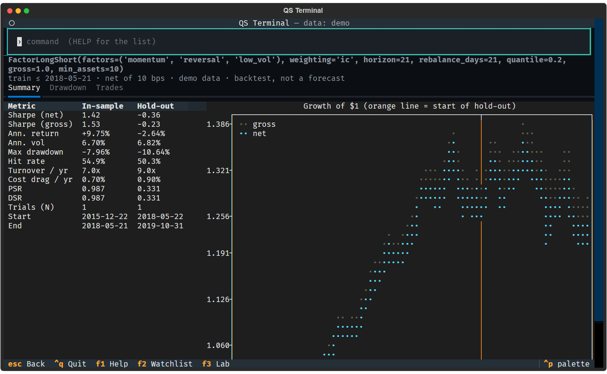
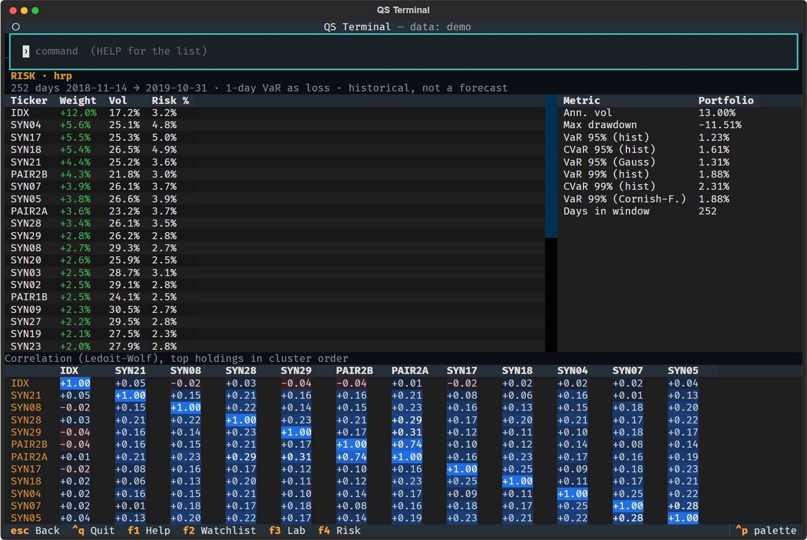
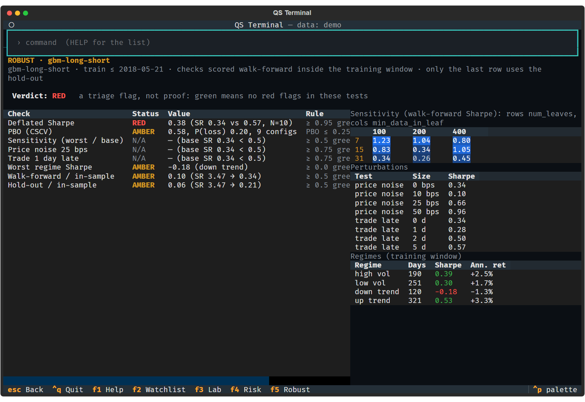
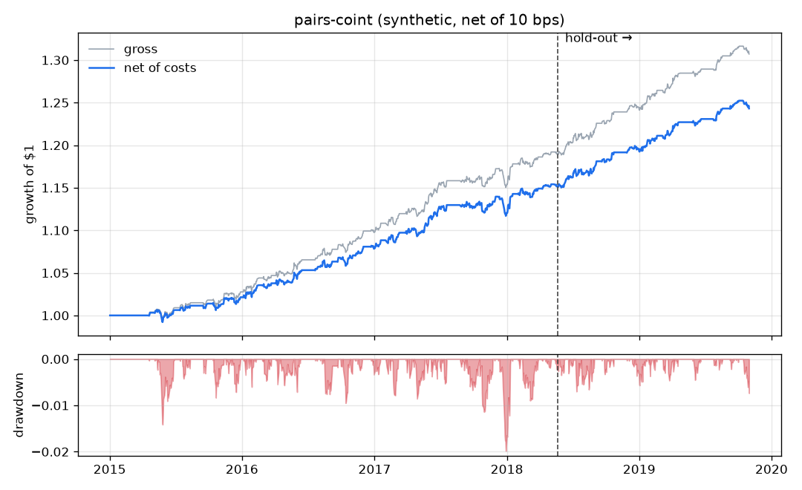

# quant-skills

A library of tested **Claude skills** for quantitative finance and ML for trading.
Each skill is a self-contained unit covering one stage of the research pipeline:
data, features, models, backtesting, portfolio risk, evaluation and robustness.
Ten strategy families from *Machine Learning for Trading* are reimplemented
from scratch and run through the same cost-aware backtester and tear sheet, then
through a robustness report that tries to break them.

> Everything here is research code. Backtests use historical or synthetic data
> and are **not** forecasts of real returns.

## Quick start

```bash
uv sync                                                        # core (no PyTorch)
uv sync --extra dl                                             # + PyTorch (CPU) for strategies #9, #10
uv run pytest                                                  # offline, about a minute
uv run python skills/backtesting/scripts/run_backtest.py       # strategy #1 on synthetic data
uv run python skills/evaluation/scripts/select_and_deflate.py  # sweep → deflated Sharpe → hold-out
uv run python skills/evaluation/scripts/strategy_gallery.py    # all 10 strategies, one table
uv run python skills/robustness/scripts/robustness_report.py --strategy pairs-coint  # DSR, PBO, perturbations
uv run python skills/data-loading/scripts/fetch.py --tickers SPY QQQ IWM  # real data into data/
uv run qs-terminal --demo                                      # the terminal, on synthetic data
```

## QS Terminal

A keyboard-driven research terminal (Textual): watchlist, quotes, charts,
a strategy lab that backtests any of the ten strategies in a background worker,
a results view with in-sample vs hold-out metrics, equity, drawdown and the trade
list, a risk screen (`RISK hrp`, F4) with weights, VaR/CVaR and a clustered
correlation heatmap, and a robustness screen (`ROBUST gbm-long-short`, F5) with a
red/amber/green verdict. Type `HELP` inside it, or see [docs/terminal.md](docs/terminal.md).






## What's different
- **Costs on by default** (5 + 5 bps). Weights drift between rebalances and turnover is charged on the drifted book.
- **Look-ahead tests:** `assert_no_lookahead` scrambles the future and checks
  that past feature values don't move. Every factor and all ten strategies are tested with it (news included, for #8),
  and a second test checks that `fit` gives the same answer when the hold-out is scrambled.
- **Purged, embargoed CV** for every ML model. The models demo shows shuffled K-fold
  "finding" an IC of 0.29 on pure noise.
- **Honest reporting:** every tear sheet carries PSR and the **deflated Sharpe
  ratio** over all trials tried, and the hold-out is kept separate.
- **Null tests:** the synthetic generator can plant a known signal or none at
  all, so we can check that a method finds the first and not the second.
- **Robustness report** for every strategy: PBO (CSCV), price-noise, execution-delay and
  parameter-sensitivity tests, and regimes, all run **walk-forward inside the training
  window** so they never spend the hold-out. Write-up: [docs/robustness.md](docs/robustness.md).

## Results gallery

All numbers are on **synthetic** prices: illustrations of the machinery, not
evidence about markets. Default params, 10 bps costs, last 30% held out and touched once.
Synthetic-plus panel = 30 one-factor stocks + 3 planted cointegrated pairs + a GARCH index
(`skills/evaluation/scripts/strategy_gallery.py`).

| # | Strategy | Book ch. | In-sample Sharpe | Walk-forward Sharpe † | Hold-out Sharpe | Hold-out 90% CI (Bayes) | Robustness | Write-up |
|---|---|---|---|---|---|---|---|---|
| 1 | Factor long-short | 7, 8 | 0.99 | 1.34 | 0.10 | [-1.25, 1.42] | 🔴 red | [README](strategies/factor-long-short/README.md) |
| 2 | Linear forecast (ridge, purged CV) | 11 | 1.23 | 0.62 | -0.07 | [-1.42, 1.26] | 🔴 red | [README](strategies/linear-forecast/README.md) |
| 3 | Pairs, cointegration | 9 | 1.87 | 2.04 | 2.56 | [1.20, 3.90] | 🟠 amber | [README](strategies/pairs-coint/README.md) |
| 4 | Volatility timing (GARCH) | 9 | 0.61 | 0.90 | 2.87 * | [1.51, 4.21] | 🟠 amber | [README](strategies/vol-timing/README.md) |
| 5 | Bayesian pairs (Kalman) | 9, 16 | 2.87 | 2.21 | 1.10 | [-0.37, 2.55] | 🟠 amber | [README](strategies/bayes-pairs/README.md) |
| 6 | LightGBM long-short + SHAP | 12 | 3.47 | 0.34 | 0.21 | [-1.14, 1.54] | 🔴 red | [README](strategies/gbm-long-short/README.md) |
| 7 | Unsupervised risk (HRP) | 14, 17 | 0.56 | 0.85 | -0.60 | [-1.95, 0.73] | 🔴 red | [README](strategies/unsupervised-risk/README.md) |
| 8 | News sentiment (TF-IDF, synthetic headlines) | 10 | 2.11 | 1.10 | -0.28 ‡ | [-1.63, 1.05] | 🔴 red | [README](strategies/text-sentiment/README.md) |
| 9 | Deep-learning forecast (1-D CNN) `dl` | 13 | 0.58 | 0.73 | -0.24 | [-1.60, 1.08] | 🔴 red | [README](strategies/dl-forecast/README.md) |
| 10 | Conditional autoencoder `dl` | 14 | 1.19 | -0.73 | -0.99 | [-2.34, 0.34] | 🔴 red | [README](strategies/cond-autoencoder/README.md) |

\* Buy-and-hold of the same index scores 2.83: the vol target controls risk (10.3% vs 16.6% vol), not return.

‡ Gross of costs 0.73: the news book turns over 88x a year. Over seeds 1 and 2 it scored 2.30 and 1.31.

† Walk-forward *inside the training window*: each day traded by a model fitted only on
earlier days. It needs no hold-out, and it catches LightGBM's overfitting (3.47 → 0.34).
Robustness = worst of the graded checks (8, or 9 with adversarial text for #8) ([docs/robustness.md](docs/robustness.md)); red
also marks failures the training window could not see (#7).

What the table teaches:
- **Flexible models overfit in-sample.** LightGBM goes from 3.47 to 0.21 on the hold-out.
  Purged CV kept it to 3 trees, and it still overfit.
- **Only planted structure survives the hold-out.** The pairs strategies find the three planted
  pairs. Without a multiple-testing correction, one fluke pair turns the pairs hold-out negative.
- **A single Sharpe hides its uncertainty.** Most hold-out intervals include zero.
- **Walk-forward predicts most hold-out failures without spending the hold-out**,
  but not all of them: #1 and #7 look fine walk-forward and still fail.
- **More model is not more signal.** On a 30-stock daily panel the networks (#9, #10) find
  little; early stopping halts #9 after a few epochs, and #10 explains returns (R² 0.30)
  without predicting them. News (#8) carries real signal that costs and a day's delay erase.



Strategy #1 on the plain synthetic panel, and its noise-only control, is in its
[write-up](strategies/factor-long-short/README.md): the in-sample Sharpe is 1.42
with a signal and 1.32 without one. After a 12-config sweep, the DSR is 0.56.

## Skills

| Skill | Status | What it does |
|---|---|---|
| [data-loading](skills/data-loading/SKILL.md) | ✅ | yfinance + parquet cache, validation, synthetic panels |
| [features-alpha](skills/features-alpha/SKILL.md) | ✅ | momentum / reversal / low-vol factors, labels, IC |
| [backtesting](skills/backtesting/SKILL.md) | ✅ | cost-aware backtester, `Strategy` interface, train/hold-out runner |
| [evaluation](skills/evaluation/SKILL.md) | ✅ | metrics, tear sheet, PSR / DSR, Bayesian Sharpe, parameter sweeps |
| [models](skills/models/SKILL.md) | ✅ | feature/label panels, purged + embargoed CV, ridge/lasso/logistic, LightGBM + SHAP, headline sentiment, PyTorch nets (`dl` extra) |
| [portfolio-risk](skills/portfolio-risk/SKILL.md) | ✅ | Ledoit-Wolf, min-variance, mean-variance, HRP, PCA eigenportfolios, VaR/CVaR |
| [robustness](skills/robustness/SKILL.md) | ✅ | DSR, PBO (CSCV), noise / delay / sensitivity tests, regimes, calibration, R/A/G verdict |
| fundamental-pitch | ⏳ Phase 6 | DCF + one-page pitch |

## Build checklist

- [x] **Phase 1: Foundation:** scaffold, CI, data-loading, backtesting, evaluation, `Strategy` interface, strategy #1
- [x] **Phase 2: Terminal MVP:** command bar, watchlist, quote, chart, strategy lab, results (`uv run qs-terminal`)
- [x] **Phase 3: Core strategies:** #2–#7, models, portfolio-risk, risk screen (`RISK`, F4)
- [x] **Phase 4: Robustness:** module, `ROBUST` screen (F5), [write-up](docs/robustness.md) (adversarial text stress waits for #8)
- [x] **Phase 5: Advanced strategies:** #8 news sentiment (+ adversarial text tests), #9 deep learning, #10 conditional autoencoder (`dl` extra)
- [ ] Phase 5 stretch: #11 synthetic data (TimeGAN-style), #12 deep RL agent
- [ ] Phase 6: fundamental-pitch, terminal polish

## Layout
Logic lives in `src/quantskills/`. Skills hold `SKILL.md`, thin scripts, a
demo notebook (under 2 min) and tests. See [CLAUDE.md](CLAUDE.md) for conventions
and [docs/references.md](docs/references.md) for sources and the book chapter map.

License: MIT.
