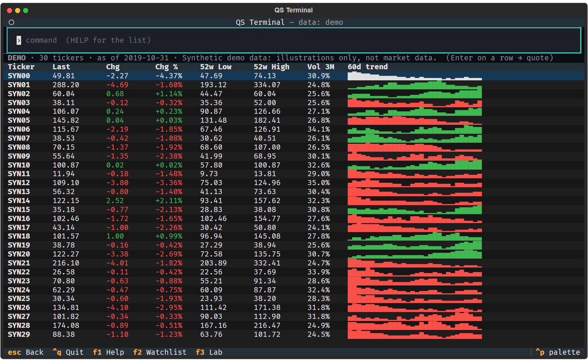

# quant-skills

A library of tested **Claude skills** for quantitative finance and ML for trading.
Each skill is a self-contained unit covering one stage of the research pipeline:
data, features, backtesting, evaluation and (soon) robustness.

> Everything here is research code. Backtests use historical or synthetic data
> and are **not** forecasts of real returns.

## Quick start

```bash
uv sync
uv run pytest                                                  # offline, about 5 s
uv run python skills/backtesting/scripts/run_backtest.py       # strategy #1 on synthetic data
uv run python skills/evaluation/scripts/select_and_deflate.py  # sweep → deflated Sharpe → hold-out
uv run python skills/data-loading/scripts/fetch.py --tickers SPY QQQ IWM  # real data into data/
uv run qs-terminal --demo                                      # the terminal, on synthetic data
```

## QS Terminal

A keyboard-driven research terminal (Textual): watchlist, quotes, charts,
a strategy lab that backtests in a background worker, and a results view with
in-sample vs hold-out metrics, equity, drawdown and the trade list. Type `HELP`
inside it, or see [docs/terminal.md](docs/terminal.md).




## What's different
- **Costs on by default** (5 + 5 bps). Weights drift between rebalances and turnover is charged on the drifted book.
- **Look-ahead tests:** `assert_no_lookahead` scrambles the future and checks
  that past feature values don't move. Every factor and strategy is tested with it.
- **Honest reporting:** every tear sheet carries PSR and the **deflated Sharpe
  ratio** over all trials tried, and the hold-out is kept separate.
- **Null tests:** the synthetic generator can plant a known signal or none at
  all, so we can check that a method finds the first and not the second.

## Results gallery

| Strategy | Data | In-sample Sharpe (default params) | Hold-out Sharpe | DSR of best-of-12 sweep | Write-up |
|---|---|---|---|---|---|
| #1 Factor long-short | synthetic | 1.42 | -0.36 | 0.56 | [README](strategies/factor-long-short/README.md) |


The noise-only panel produces nearly the same in-sample Sharpe (1.32), and that is
the lesson of strategy #1. See the write-up.

## Skills

| Skill | Status | What it does |
|---|---|---|
| [data-loading](skills/data-loading/SKILL.md) | ✅ | yfinance + parquet cache, validation, synthetic panels |
| [features-alpha](skills/features-alpha/SKILL.md) | ✅ | momentum / reversal / low-vol factors, labels, IC |
| [backtesting](skills/backtesting/SKILL.md) | ✅ | cost-aware backtester, `Strategy` interface, train/hold-out runner |
| [evaluation](skills/evaluation/SKILL.md) | ✅ | metrics, tear sheet, PSR / DSR, parameter sweeps |
| models | ⏳ Phase 3 | purged CV, linear / GBM models |
| portfolio-risk | ⏳ Phase 3 | mean-variance, HRP, VaR/CVaR |
| robustness | ⏳ Phase 4 | PBO, perturbation tests, calibration |
| fundamental-pitch | ⏳ Phase 6 | DCF + one-page pitch |

## Build checklist

- [x] **Phase 1: Foundation:** scaffold, CI, data-loading, backtesting, evaluation, `Strategy` interface, strategy #1
- [x] **Phase 2: Terminal MVP:** command bar, watchlist, quote, chart, strategy lab, results (`uv run qs-terminal`)
- [ ] Phase 3: Strategies #2–#7, portfolio-risk, risk screen
- [ ] Phase 4: Robustness module + screen + write-up
- [ ] Phase 5: Strategies #8–#10 (`dl` extra), stretch #11–#12
- [ ] Phase 6: fundamental-pitch, terminal polish

## Layout
Logic lives in `src/quantskills/`. Skills hold `SKILL.md`, thin scripts, a
demo notebook (under 2 min) and tests. See [CLAUDE.md](CLAUDE.md) for conventions
and [docs/references.md](docs/references.md) for sources and the book chapter map.

License: MIT.
