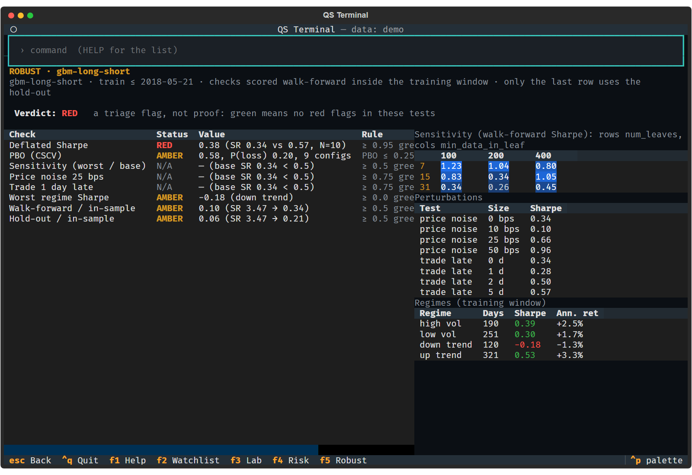
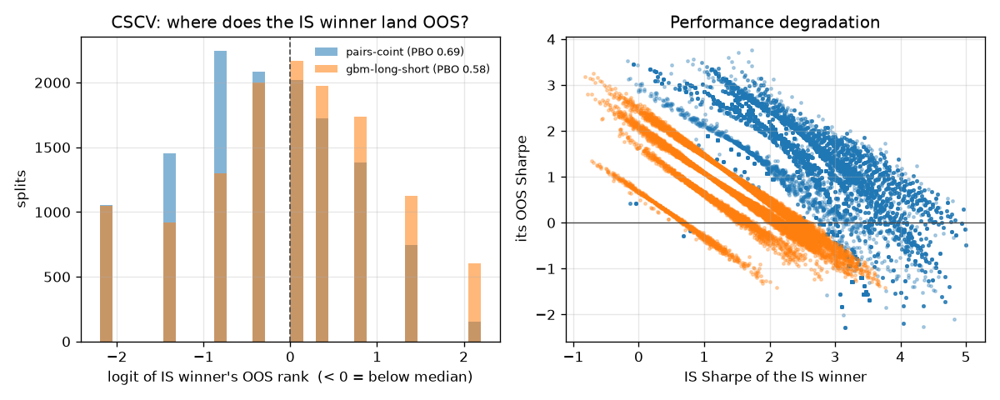
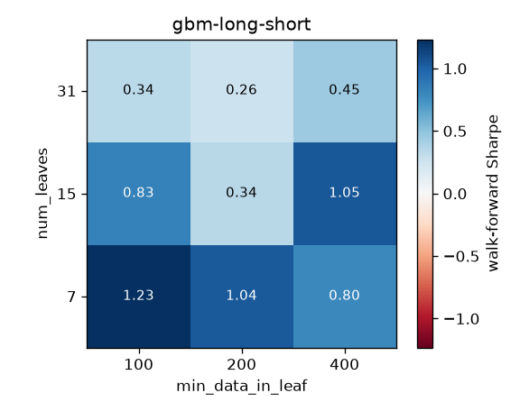
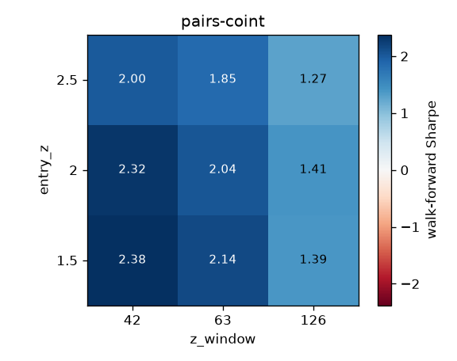
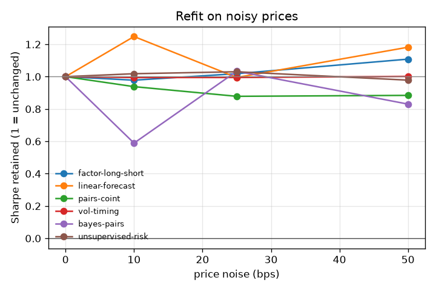
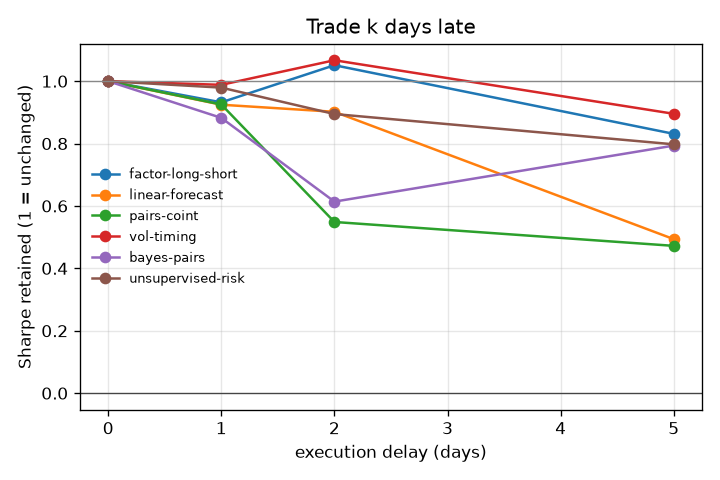
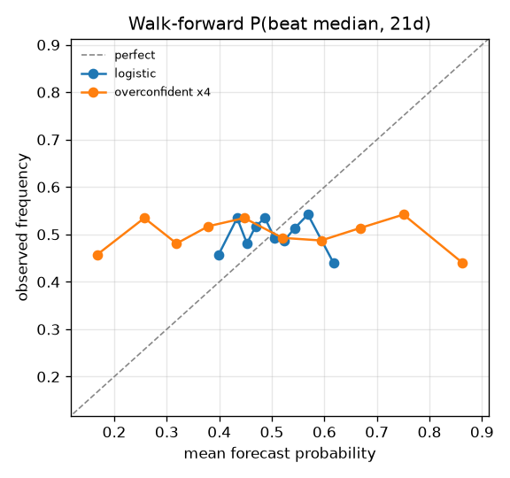

# Robustness: is the edge real?

A backtest is the best of many tries on one history. This module asks whether the
result survives the questions a sceptical reviewer would ask, and grades each answer
red / amber / green. Code: `src/quantskills/robustness/`; skill:
[skills/robustness](../skills/robustness/SKILL.md); terminal: `ROBUST <strategy>` (F5).

> All numbers here are on **synthetic** prices (30 one-factor stocks + 3 planted
> cointegrated pairs + a GARCH index, seed 0). They show what the tests do, not
> anything about real markets.

## The one rule: never spend the hold-out on diagnostics

Every check runs on the **training window** (the first 70% of history). The hold-out
appears in exactly one row, the last one, from the same single `run_strategy` call
the gallery uses. So the report can be re-run as often as you like, as long as
nobody re-tunes after reading that row.

Inside the training window, checks are scored **walk-forward**: split the window into
an initial fit period (50%) and 4 test blocks; for each block, fit only on dates
before it and trade it. Every scored day was traded by a model that had not seen it.

Why not just score in-sample? The first version did, and it was blind to the most
important failure. LightGBM (#6) passed every in-sample check, then fell from a
Sharpe of 3.47 to 0.21 on the hold-out. A model scored on the days it memorised looks
equally good under noise, delays and nearby parameters. Walk-forward exposes it
without touching the hold-out (3.47 → 0.34).



## Results: all seven strategies

`uv run python skills/robustness/scripts/robustness_report.py --all --figures`

| # | Strategy | Verdict | DSR | PBO / P(loss) | Noise kept | 1-day delay kept | Sharpe IS → walk-fwd | Hold-out Sharpe |
|---|---|---|---|---|---|---|---|---|
| 1 | `factor-long-short` | **RED** | 0.872 | 0.81 / 0.11 | 1.02 | 0.93 | 0.99 → 1.34 | 0.10 |
| 2 | `linear-forecast` | **RED** | 0.375 | 0.54 / 0.29 | 0.99 | 0.92 | 1.23 → 0.62 | -0.07 |
| 3 | `pairs-coint` | **AMBER** | 0.948 | 0.69 / 0.15 | 0.88 | 0.93 | 1.87 → 2.04 | 2.56 |
| 4 | `vol-timing` | **AMBER** | 0.866 | 0.60 / 0.07 | 0.99 | 0.99 | 0.61 → 0.90 | 2.87 |
| 5 | `bayes-pairs` | **AMBER** | 0.976 | 0.65 / 0.01 | 1.03 | 0.88 | 2.87 → 2.21 | 1.10 |
| 6 | `gbm-long-short` | **RED** | 0.381 | 0.58 / 0.20 | — | — | 3.47 → 0.34 | 0.21 |
| 7 | `unsupervised-risk` | **RED** | 0.847 | 0.81 / 0.14 | 1.03 | 0.98 | 0.56 → 0.85 | -0.60 |

PBO is shown with P(loss), the chance the in-sample winner loses money out of sample.
"Kept" is the share of the walk-forward Sharpe left after the perturbation. The hold-out
column is the same number as in the README gallery.

**What the table shows**

1. **Walk-forward vs in-sample catches memorisation without the hold-out.**
   LightGBM (3.47 → 0.34) and the linear forecast (1.23 → 0.62) both lose most of their
   in-sample Sharpe when each day is traded by a model that hadn't seen it. Both then
   disappoint on the hold-out (0.21 and -0.07). Their deflated Sharpes are red (0.38).
2. **Planted structure passes.** Both pairs strategies and vol timing keep their Sharpe
   walk-forward, under 25 bps of price noise and a day of delay, across their parameter
   grids, and in every regime. They were the three strategies that held up on the hold-out.
3. **The checks are necessary, not sufficient.** Factor long-short (#1) and the HRP
   allocator (#7) look fine walk-forward (1.34 and 0.85) and still fail the hold-out.
   For #1 the regime check is the warning: its walk-forward Sharpe is -1.34 in
   down-trending markets. Nothing in the training window predicted #7's failure. Its
   edge (long-only, low-vol tilt) depends on the market's path, and the hold-out
   took a different one. No test replaces data the strategy has never seen.
4. **PBO is high almost everywhere (0.54–0.81).** That's expected with 3×3 grids where
   neighbouring configs behave alike: picking the in-sample best of nine similar
   configs is close to a coin flip. P(loss) separates "harmless plateau" (bayes-pairs:
   0.01; vol timing: 0.07) from "the winner often loses" (linear forecast: 0.29).

## The checks

### Deflated Sharpe (DSR)
P(true Sharpe > the best Sharpe you'd expect from N skill-less tries), computed on the
walk-forward returns. N = trials before the report + the 9 grid configs, and the
variance of the 9 grid Sharpes sets the null. Green ≥ 0.95, amber ≥ 0.5.

### Probability of backtest overfitting (CSCV)
Combinatorially symmetric cross-validation (Bailey, Borwein, López de Prado & Zhu):
cut the walk-forward returns of all 9 grid configs into 16 blocks; for each of the
C(16, 8) = 12,870 ways to call half of them "in-sample", find the in-sample winner
and its rank on the other half. PBO is the share of splits where the winner ranks at
or below the median out of sample.



The left panel shows logits of the winner's out-of-sample rank (left of 0 means below
the median). On the right, each point is one split. The downward slope partly comes from
the method itself: in-sample and out-of-sample are the two halves of one fixed sample, so
a config that did unusually well on one half tends to do worse on the other. What
matters is the level: pairs' winners mostly land between 0 and 3 out of sample,
LightGBM's much closer to zero.

Grade: the better of PBO (green ≤ 0.25, amber ≤ 0.5) and P(loss) (green ≤ 0.10,
amber ≤ 0.30). PBO judges the *selection*. On a plateau where every config works it
is ≈ 0.5 and harmless, so P(loss) gets a say.

**Sanity check** (`skills/robustness/tests/test_pbo.py`): 20 pure-noise configs give
PBO ≈ 0.45; give one of them a real Sharpe of ~3 and PBO drops to 0.00.

### Parameter sensitivity
Walk-forward Sharpe over a 3×3 grid of two parameters centred on the defaults
(`SENSITIVITY_AXES` in `robustness/report.py`). The grade is the worst grid Sharpe divided
by the base Sharpe: green ≥ 0.5, amber ≥ 0. A good configuration sits on a plateau.

| LightGBM: simpler is better out of sample | Pairs: a plateau |
|---|---|
|  |  |

LightGBM's grid shows the overfitting directly. The smallest trees (7 leaves, 100 rows
per leaf) score 1.23 walk-forward; the default (15 leaves, 200) scores 0.34. This is a
*training-window* finding, so it may be acted on. Re-tuning on it and then re-reading
the hold-out would count as a second trial and must be reported as such.

### Price noise
Multiply every price by exp(ε), ε ~ N(0, bps/10⁴), refit and generate signals on the
noisy data, and trade at the **clean** prices. (On noisy prices a reversal rule would
profit from the noise itself.) Two seeds per level. Green if ≥ 75% of the Sharpe
survives 25 bps.



Every strategy with a meaningful base Sharpe keeps at least 88% of it at 25 bps. The
test is itself noisy with two seeds (bayes-pairs
dips to 0.59 at 10 bps, then recovers at 25), so read the shape of each line, not one point.

### Execution delay
Trade the same targets 1, 2 or 5 days late. Green if ≥ 75% of the Sharpe survives
one day.



Mean-reversion strategies decay fastest: pairs keeps 93% of its Sharpe after one day
but about half after five, because spreads revert within days. Slow signals (vol timing,
HRP) lose 10–20% after five days.

### Regimes
Two past-only labelings of the equal-weight index: trailing 63-day volatility above or
below its expanding median, and price above or below its 200-day average. Labels are
lagged one day before matching returns, and regimes with fewer than 63 days are not scored.
Green if the worst regime's Sharpe is ≥ 0, amber ≥ -1. The bar is low because losing in
one regime is common; losing badly is a warning.

### Retention needs a real base
The noise, delay and sensitivity grades are ratios against the walk-forward Sharpe. When
that base is below 0.5 they show `n/a`, because a ratio against a near-zero Sharpe is noise
(LightGBM: "1.92 kept"). A weak strategy is already flagged by its DSR.

### Calibration
For models that output probabilities. Brier score, log loss, the Murphy decomposition
(reliability, resolution) and expected calibration error (ECE), all on **walk-forward**
probabilities from `quantskills.models.oof_predictions`.



`uv run python skills/robustness/scripts/calibration_report.py`. Logistic regression for
P(stock beats the median over 21 days) on the plain synthetic panel scores Brier 0.2544
against 0.2500 for always saying 50% (skill -0.018). Its most confident bin says 62%
and comes true 44% of the time. Sharpening the same forecasts ×4 keeps the ranking
but raises ECE from 0.057 to 0.188. Ranking strategies can live with poor calibration;
anything that sizes positions from a probability cannot.

## Thresholds

All in `THRESHOLDS` in `src/quantskills/robustness/verdict.py`:

| Check | Green | Amber | Why |
|---|---|---|---|
| Deflated Sharpe | ≥ 0.95 | ≥ 0.50 | the usual 95% confidence; below 50% the best try is more likely noise than not |
| PBO / P(loss) | ≤ 0.25 / ≤ 0.10 | ≤ 0.50 / ≤ 0.30 | 0.5 is the coin flip; P(loss) rescues plateaus |
| Sensitivity (worst / base) | ≥ 0.5 | ≥ 0 | a neighbour may be worse, but should not lose money |
| Price noise 25 bps (kept) | ≥ 0.75 | ≥ 0.40 | 25 bps is a realistic data error for daily closes |
| 1-day delay (kept) | ≥ 0.75 | ≥ 0.40 | a day of slippage in execution should not halve the edge |
| Worst regime Sharpe | ≥ 0 | ≥ -1 | see above |
| Walk-forward / in-sample, hold-out / in-sample | ≥ 0.5 | ≥ 0 | half the Sharpe surviving is a typical healthy decay |

The overall verdict is the worst graded check. These are judgement calls, kept in one
place so they are easy to audit and change.

## Honesty notes

- **This design came after seeing the hold-out.** Phase 3 had already read every
  strategy's hold-out once. The switch from in-sample to walk-forward checks was
  prompted by LightGBM's hold-out failure, and the thresholds were set with these
  results in view. The method is sound regardless, but the claim "the training-window
  checks predicted the hold-out" is retrospective. The test that it would generalise
  is a new dataset (e.g. `--data cache`, or another synthetic seed).
- **Small grids.** Nine configs make PBO coarse. A strategy with a larger search space
  should pass its real trial count via `n_trials`.
- **Synthetic data.** The planted effects (momentum drift, cointegrated pairs, GARCH
  volatility) are simple and stationary. Real markets are neither.
- **Not yet covered:** adversarial stress tests for text/sentiment signals arrive with
  strategy #8 (Phase 5).

## Reproduce

```bash
uv run python skills/robustness/scripts/robustness_report.py --strategy pairs-coint
uv run python skills/robustness/scripts/robustness_report.py --all --figures   # ~3 min
uv run python skills/robustness/scripts/calibration_report.py --figure docs/img/robustness/reliability.png
uv run qs-terminal --demo     # then: ROBUST gbm-long-short
```
