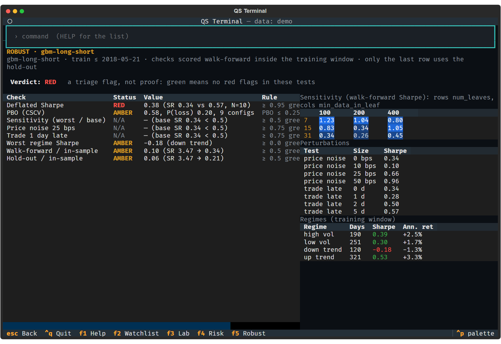

# QS Terminal

A keyboard-driven research terminal built with [Textual](https://textual.textualize.io/).
It is a thin UI over `quantskills`: it parses commands, calls library
functions and draws the results. It holds no quant logic of its own.

```bash
uv run qs-terminal            # cached prices from data/ (offline)
uv run qs-terminal --demo     # synthetic prices and headlines, no download needed
```

If the cache is empty, the watchlist says so and tells you how to fill it
(`skills/data-loading/scripts/fetch.py`) or to switch to `DATA DEMO`.

Demo data: 30 synthetic stocks, 3 cointegrated pairs (`PAIRkA/B`) and a GARCH index
(`IDX`), so every strategy has something to work on. Strategies: `factor-long-short`,
`linear-forecast`, `pairs-coint`, `vol-timing`, `bayes-pairs`, `gbm-long-short`,
`unsupervised-risk` (listed in book order in the lab).

## Commands

| Command | What it does |
|---|---|
| `WATCH` | Watchlist: last, daily change, 52-week range, 3M vol, 60-day sparkline |
| `QUOTE <TICKER>` or just `<TICKER>` | Quote detail with 1M / 3M / YTD / 1Y returns |
| `CHART <TICKER> [1M\|3M\|6M\|1Y\|2Y\|5Y\|MAX]` | Close with SMA 50 / 200 |
| `STRAT [strategy]` | Strategy lab: pick any of the 11 strategies (#9, #10 and #12 need `uv sync --extra dl`), edit params, hold-out fraction and costs, then run |
| `BT <strategy> [key=value ...]` | Run a backtest right away, e.g. `BT pairs-coint entry_z=1.5` |
| `RESULTS` | Re-open the last backtest's results |
| `DATA DEMO\|CACHE` | Switch data source |
| `RISK [hrp\|min_var\|inverse_vol\|equal\|eigen] [lookback]` | Weights, VaR/CVaR and a correlation heatmap (default `hrp 252`) |
| `ROBUST [strategy] [key=value ...]` | Robustness report: DSR, PBO, noise / delay / sensitivity, regimes and a red/amber/green verdict. With no strategy, uses the last one you backtested |
| `HELP`, `QUIT` | |

Keys: `F1` help, `F2` watchlist, `F3` lab, `F4` risk, `F5` robustness, `ctrl+r` run (in the lab), `Esc` back,
`/` focus the command bar, `ctrl+q` quit.

## Screens

- **Watchlist**: `quote_table()` from `quantskills.data.views`. Enter on a row opens the quote.
- **Quote**: `quote_detail()`.
- **Chart**: `sma()` from `quantskills.features.indicators`, computed on full
  history and then windowed, so the averages are valid from the first bar shown.
- **Strategy lab**: the param form is generated from `Strategy.default_params()`.
  The backtest (`run_strategy`) runs in a Textual worker thread, so the UI stays responsive.
- **Results**: in-sample vs hold-out tear sheets (`tear_sheet`), equity with the
  hold-out boundary marked, drawdown, and a trade list from `BacktestResult.trades()`
  (trades are measured from the drifted book, so they match the costs charged).
- **Risk**: `risk_view()` from `quantskills.portfolio`, run in a worker thread:
  - weights, volatility and share of risk per ticker
  - historical, Gaussian and Cornish-Fisher VaR, plus CVaR at 95% and 99%
  - a Ledoit-Wolf correlation heatmap of the top 12 holdings in HRP cluster order
    (blue positive, red negative)

  These are in-window numbers, a description and not a forecast.
- **Robustness**: `robustness_report()` from `quantskills.robustness`, run in a worker
  thread (2-40 s; the status line shows progress):
  - a verdict banner (worst of the graded checks) and the checks table: deflated Sharpe,
    PBO with P(OOS loss), sensitivity, 25 bps price noise, a 1-day delay, worst regime,
    walk-forward / in-sample and hold-out / in-sample
  - the two-parameter sensitivity surface as a heatmap, noise and delay Sharpes, and
    the regime table

  Every check except the last row runs walk-forward inside the training window.
  See [robustness.md](robustness.md).



## Layout

```
src/quantskills/terminal/
├── app.py        # App, command dispatch, CSS, entry point
├── commands.py   # command grammar (pure, unit-tested)
├── screens.py    # one Screen class per view
├── state.py      # loaded data + last run
└── fmt.py        # display formatting only
```

## Tests

`tests/terminal/test_app.py` drives each screen with Textual's `App.run_test()` pilot:
empty-cache message, watchlist → quote → back, chart and help, the lab running a
backtest in a worker, `BT` with good and bad params, invalid lab input, the risk
screen (weights, metrics, heatmap, bad methods and windows), the robustness
screen (checks, surface, F5 reusing the last backtest, bad input), and a `BT` run of
**every** registered strategy.
`tests/terminal/test_commands.py` covers the parser.

Original code and look. Fincept Terminal and Bloomberg were UX inspiration only;
no code or branding is used.
