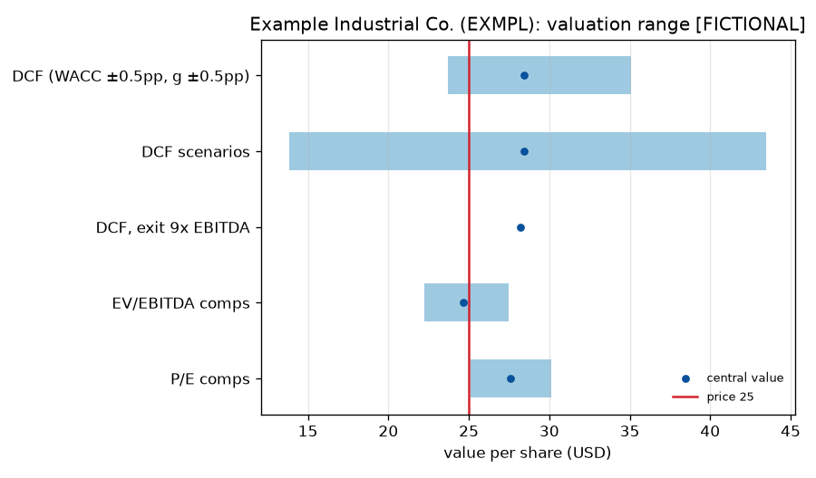

# Example Industrial Co. (EXMPL) — FICTIONAL EXAMPLE

**Price 25.00 USD** (illustrative) · base-case DCF **28.44** · **Base-case value is within 15% of the price**

_Illustrative analysis of stated assumptions. Not investment advice: a DCF is only as good as its inputs, and small changes in WACC or terminal growth move the value a lot._

## Thesis
- Illustrative: margins recover from 12% to 14% as a pricing reset passes through, the kind of claim a real thesis must back with evidence.
- Illustrative: modest growth (6% falling to 4%) is enough; the case does not rely on a re-rating.

## Valuation

- **DCF (FCFF, 5-year forecast):** EV 4,313m, equity 3,413m, 28.44 per share. The terminal value is **78%** of EV.
- **WACC 8.4%:** cost of equity 9.7% (beta 1.1), pre-tax cost of debt 6.0%, 25% debt. Terminal growth 2.5%.
- **Reverse DCF:** the price implies revenue growth of **1.9% a year** for 5 years at these margins; the base case assumes 5.0% on average.
- **Year-1:** revenue 2,544m, EBITDA 420m, EPS 1.67.

| method | low | mid | high |
|---|---|---|---|
| DCF (WACC ±0.5pp, g ±0.5pp) | 23.71 | 28.44 | 35.08 |
| DCF scenarios | 13.85 | 28.44 | 43.47 |
| DCF, exit 9x EBITDA | 28.18 | 28.18 | 28.18 |
| EV/EBITDA comps | 22.23 | 24.68 | 27.48 |
| P/E comps | 25.08 | 27.59 | 30.10 |

**Sensitivity (value per share):**

|  | g 2.0% | g 2.5% | g 3.0% |
|---|---|---|---|
| WACC 7.4% | 32.35 | 35.73 | 39.88 |
| WACC 8.4% | 26.14 | 28.44 | 31.16 |
| WACC 9.4% | 21.61 | 23.26 | 25.16 |

## Catalysts
- Illustrative: two quarters of margin expansion in reported results.

## Risks
- Illustrative: the margin recovery stalls; in the bear case the value falls below the price.
- Illustrative: 9x EBITDA peers may be cheaper for a reason (cyclicality, leverage).

---
Generated 2026-11-24 by quantskills.fundamental from the case file. Sources: invented numbers for a teaching example; no real company.
