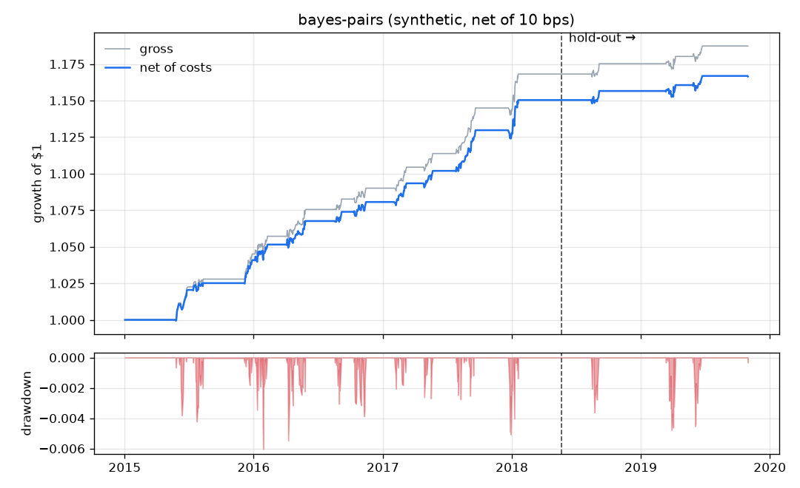

# Strategy #5: Bayesian pairs (Kalman hedge ratio) and the Bayesian Sharpe

**Code:** `src/quantskills/strategies/bayes_pairs.py`, `src/quantskills/eval/bayes.py` · **Book:** ML4T 3rd ed., ch. 9 (Kalman filter, rolling hedge ratios), ch. 16 (Sharpe inference) · **Status:** Phase 3, synthetic data only

## Hypothesis
As in #3, but the hedge ratio between two cointegrated assets drifts. A Bayesian
estimate updated every day tracks it, where #3's frozen OLS ratio goes stale.
And instead of one Sharpe number, we want a **posterior distribution** that says
how sure we can be.

## Method
1. Select pairs on the training window exactly as in #3 (Engle-Granger + Bonferroni).
2. **State-space model, updated daily by Bayes' rule (the Kalman filter):**
   - `log y_t = c_t + h_t · log x_t + e_t` with `e ~ N(0, R)`
   - `(c_t, h_t)` follow a random walk with variance `delta · R`.
   - The prior is the training OLS fit, and `R` is its residual variance.
3. The one-step prediction error divided by its predicted standard deviation is a
   z-score that already accounts for uncertainty in the hedge ratio. Trade the same
   bands as #3 (±2 entry, ±0.5 exit, ±4 stop), hedging with that day's posterior ratio.
4. **Bayesian Sharpe** (`eval.bayesian_sharpe`):
   - Model daily returns as Normal(mu, sigma²) with the flat prior 1/sigma².
   - The posterior has a closed form, so it is sampled exactly with numpy; no PyMC needed.
   - Each draw of (mu, sigma) gives one Sharpe value.

## Results (synthetic-plus panel, seed 0, 10 bps costs)

Illustrations only.

| | IS Sharpe | Hold-out Sharpe | Hold-out 90% credible interval | P(Sharpe > 0) | Turnover/yr |
|---|---|---|---|---|---|
| `bayes-pairs` (delta = 1e-5) | 2.87 | **1.10** | [-0.37, 2.55] | 0.89 | 1.9x |
| `pairs-coint` (#3, fixed ratio) | 1.87 | 2.56 | [1.20, 3.90] | ~1.00 | 11.6x |

Filtered hedge ratios barely move on this data: `PAIR1A/PAIR1B` goes 1.255 → 1.253.
The planted ratio is constant, so the filter correctly finds little to update.

### What this shows
- **The posterior shows what one Sharpe number hides.** The hold-out Sharpe of 1.10
  has a 90% interval that includes zero. With about 1 year of data, a Sharpe of 1
  is weak evidence. The in-sample interval is [1.93, 3.80].
- With a constant true hedge ratio, the Kalman version trades less (1.9x against
  11.6x a year) and earns less than #3. Its innovations are less extreme, so it
  enters fewer trades. It should earn its keep when the ratio really drifts (see
  `test_kalman_tracks_a_moving_hedge_ratio`).
- **Sensitivity, flagged:** a smaller `delta` (1e-6) gave a hold-out Sharpe of 2.2,
  and a larger one (1e-4) gave 1.0. We **did not** adopt 1e-6: that would be
  choosing a parameter by its hold-out result. A fresh hold-out is needed to test it.

## Failure modes
- **`delta` too large:** the filter "explains away" the spread by moving the intercept,
  so z never reaches the band.
- **Model risk in the Sharpe posterior:** i.i.d. normal returns ignore fat tails and
  autocorrelation. Treat the interval as a *lower bound* on the uncertainty.
- Everything from #3: broken relationships, survivorship, shorting costs.

## Next steps
- A synthetic pair with a drifting hedge ratio, to show where #5 beats #3.
- Full PyMC model (Student-t returns) as an optional extra, if the dependency is approved.
