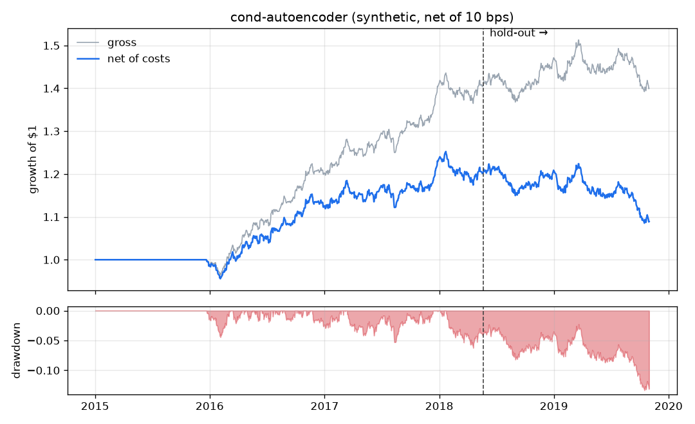

# Strategy #10: Conditional autoencoder factors

**Code:** `src/quantskills/strategies/cond_autoencoder.py`, `models/nn.py` · **Book:** ML4T 3rd ed., ch. 14 (latent factor models, conditional autoencoders) · **Status:** Phase 5, synthetic data only · **Needs:** `uv sync --extra dl`

## Hypothesis
Stock returns follow a few hidden factors, and a stock's exposure to them (its betas)
depends on its characteristics. If some factors earn a premium on average, stocks whose
characteristics give them high exposure to those factors should earn more.

## Method
After Gu, Kelly & Xiu (2021), "Autoencoder Asset Pricing Models":

    r(i, t+5) = beta(z(i, t)) · f(t+5) + noise

1. **Characteristics** `z`: the seven panel features (momentum, reversal, volatility,
   trend), z-scored across stocks each day, plus a constant.
2. **Beta network:** characteristics → 16 hidden units → 3 betas per stock.
3. **Factor network:** first the *managed portfolios*, the cross-sectional regression of
   returns on characteristics, x = (Z'Z)⁻¹Z'r; then a linear layer to 3 factors.
4. **Training:** reconstruct non-overlapping 5-day returns over the training window.
   Full-batch Adam with a small L1 penalty, early stopping on validation R² (the last
   20% of training dates, one block apart).
5. **Trading:** the expected return known at *t* is beta(z_t) · λ, where λ is each
   factor's average over the training window (its premium). A quantile long-short book
   every 5 days, 10 bps costs, last 30% held out.

## Results (synthetic-plus panel, seed 0, 10 bps costs)

Illustrations of the pipeline on simulated prices, not evidence about markets.

| Measure | Value |
|---|---|
| Total R², training / validation (how well 3 factors explain returns) | 0.32 / 0.30 |
| **Predictive R²**, validation (beta · λ vs realised returns) | **-0.02** |
| In-sample Sharpe | 1.19 |
| **Hold-out Sharpe** | **-0.99** (gross -0.02) |
| Turnover | 64x / yr |
| Positive control (3x stronger drift): IS / hold-out Sharpe | 3.71 / -0.66 |

Hold-out 90% Bayesian interval: [-2.34, 0.34].

### What this shows
- **Explaining returns is not predicting them.** Three factors explain 30% of the
  variation in 5-day returns out of sample (mostly the market factor the generator
  builds in). But the premia estimated in-sample don't forecast the cross-section
  (predictive R² < 0), and the strategy loses after costs.
- **The in-sample Sharpe is an artefact.** λ is the average factor return over the very
  window the strategy is then scored on.
- In Gu, Kelly & Xiu, the gain over simpler models shows up with ~90 characteristics and
  60 years of monthly data. Seven features and five years of daily synthetic data are far
  too little; the pipeline is the point here.

## Robustness
Verdict: **RED** (`uv run python skills/robustness/scripts/robustness_report.py --strategy cond-autoencoder`). Every check runs walk-forward inside the training window except the last row. Method: [docs/robustness.md](../../docs/robustness.md).

| Check | Value | Rule | Status |
|---|---|---|---|
| Deflated Sharpe | 0.016 (SR -0.73 vs 0.89, N=10) | ≥ 0.95 green, ≥ 0.5 amber | red |
| PBO (CSCV) | 0.61, P(loss) 0.88, 9 configs | PBO ≤ 0.25 or P(loss) ≤ 0.1 green | red |
| Sensitivity (worst / base) | — (base SR -0.73 < 0.5) | ≥ 0.5 green, ≥ 0.0 amber | n/a |
| Price noise 25 bps | — (base SR -0.73 < 0.5) | ≥ 0.75 green, ≥ 0.4 amber | n/a |
| Trade 1 day late | — (base SR -0.73 < 0.5) | ≥ 0.75 green, ≥ 0.4 amber | n/a |
| Worst regime Sharpe | -1.87 (down trend) | ≥ 0.0 green, ≥ -1.0 amber | red |
| Walk-forward / in-sample | -0.61 (SR 1.19 → -0.73) | ≥ 0.5 green, ≥ 0.0 amber | red |
| Hold-out / in-sample | -0.83 (SR 1.19 → -0.99) | ≥ 0.5 green, ≥ 0.0 amber | red |

Red on every graded check: it already loses walk-forward inside the training window (-0.73), the in-sample winner loses out of sample in 88% of CSCV splits, and it is worst in down-trending markets (-1.87). The 1.19 in-sample Sharpe is the factor premia scored on the window they were estimated from.

## Failure modes
- **Premia estimation:** λ from a few years of data is very noisy; high-beta-to-the-market
  tilts can dominate the forecast.
- **Turnover:** betas follow fast-moving characteristics (reversal), so the book churns.
  Slower characteristics or longer rebalancing would help.
- **Survivorship and look-ahead in characteristics:** with real data, use point-in-time
  fundamentals only.

## Next steps
- Monthly horizon, more characteristics, and an ensemble over seeds as in the paper.
- Report the factor betas' stability across walk-forward folds.
