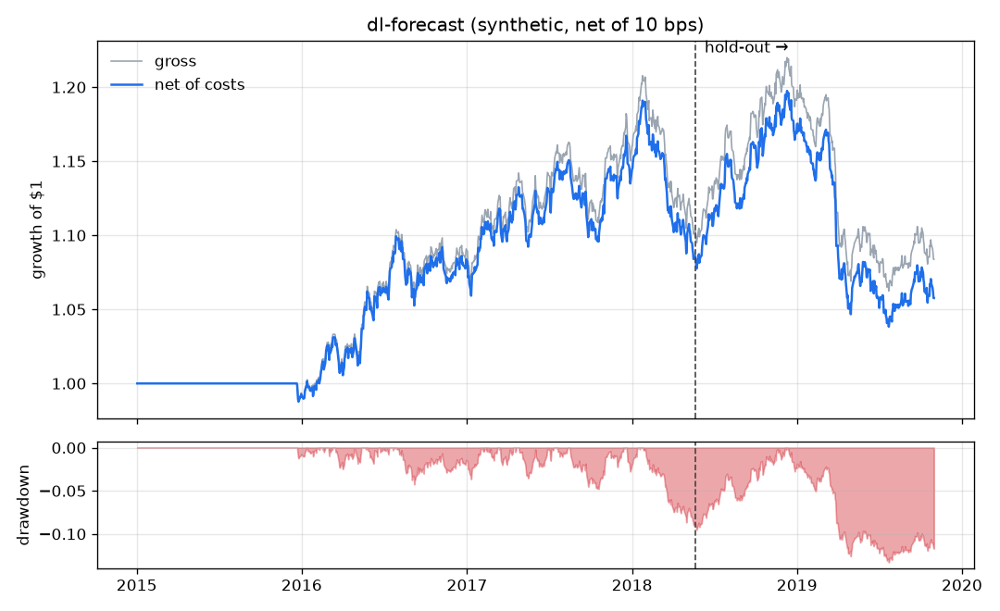

# Strategy #9: Deep-learning return forecast (MLP / 1-D CNN / LSTM)

**Code:** `src/quantskills/strategies/dl_forecast.py`, `models/nn.py` · **Book:** ML4T 3rd ed., ch. 13 (deep learning for time series) · **Status:** Phase 5, synthetic data only · **Needs:** `uv sync --extra dl` (PyTorch, CPU)

## Hypothesis
A neural network can learn which past return patterns precede outperformance, from raw
return sequences, without hand-made features such as momentum.

## Method
1. **Input** per (date, stock): the last 252 daily returns minus the market's, divided by
   the stock's trailing volatility and clipped at ±5. Only data up to the date is used.
2. **Target:** the cross-sectional rank of the next 21-day return (as for #2 and #6).
3. **Architectures** (`arch`):
   - `mlp`: one hidden layer.
   - `cnn` (default): two 1-D convolutions (the second dilated) then a global average.
   - `lstm`: a 16-unit LSTM, last hidden state.
4. **Training**, on the training window only:
   - Samples every 5th date, to cut the overlap between 21-day labels.
   - The last 20% of training dates is the validation set, separated by a 21-day gap.
   - Adam with a little weight decay, then early stopping on the validation mean daily IC,
     keeping the best epoch. Seeded and single-process, so runs are repeatable.
5. A quantile long-short book every 21 days, 10 bps costs, last 30% held out.

PyTorch is imported only inside `fit` and `score`. Without the `dl` extra, the rest of the
library works and this strategy says how to install it.

## Results (synthetic-plus panel, seed 0, 10 bps costs)

Illustrations of the pipeline on simulated prices, not evidence about markets.

| Panel | Model | Best epoch | Validation IC | IS Sharpe | Hold-out Sharpe |
|---|---|---|---|---|---|
| default | MLP | 1 | 0.03 | 0.31 | 0.11 |
| default | **CNN (default)** | 4 | -0.04 | 0.58 | **-0.24** |
| default | LSTM | 1 | 0.01 | -0.60 | -0.06 |
| 3x stronger drift (positive control) | MLP | 3 | 0.06 | 3.58 | -0.90 |
| 3x stronger drift | CNN | 9 | **0.13** | 4.22 | 0.09 |
| 3x stronger drift | LSTM | 11 | 0.03 | 1.32 | -0.44 |
| 3x stronger drift, for comparison | LightGBM (#6) | | | 5.53 | 0.79 |
| 3x stronger drift, for comparison | ridge (#2) | | | 4.03 | -0.39 |

The positive control is `synthetic_prices(seed=0, drift_vol=0.0012)` instead of 0.0004.

### What this shows
- **On the default panel the networks find nothing, and early stopping notices.** The
  validation IC never rises above zero, so training stops after 1–4 epochs. The in-sample
  Sharpe stays small (unlike LightGBM's 3.47). That's the right outcome when there is
  little to learn.
- **With a stronger signal the CNN learns** (validation IC 0.13). Its training Sharpe
  jumps to 4.2, but even then its hold-out, like every model's on this seed, is noisy.
- **Raw sequences are a hard way to learn momentum.** LightGBM on hand-made features does
  better with far less compute. Deep learning pays off with more data and richer inputs
  than a 30-stock daily panel.

## Robustness
Verdict: **RED** (`uv run python skills/robustness/scripts/robustness_report.py --strategy dl-forecast`). Every check runs walk-forward inside the training window except the last row. Method: [docs/robustness.md](../../docs/robustness.md).

| Check | Value | Rule | Status |
|---|---|---|---|
| Deflated Sharpe | 0.595 (SR 0.73 vs 0.55, N=10) | ≥ 0.95 green, ≥ 0.5 amber | amber |
| PBO (CSCV) | 0.65, P(loss) 0.31, 9 configs | PBO ≤ 0.25 or P(loss) ≤ 0.1 green | red |
| Sensitivity (worst / base) | -0.03 kept (worst SR -0.02) | ≥ 0.5 green, ≥ 0.0 amber | red |
| Price noise 25 bps | 1.18 kept (SR 0.87) | ≥ 0.75 green, ≥ 0.4 amber | green |
| Trade 1 day late | 0.94 kept (SR 0.69) | ≥ 0.75 green, ≥ 0.4 amber | green |
| Worst regime Sharpe | 0.23 (down trend) | ≥ 0.0 green, ≥ -1.0 amber | green |
| Walk-forward / in-sample | 1.27 (SR 0.58 → 0.73) | ≥ 0.5 green, ≥ 0.0 amber | green |
| Hold-out / in-sample | -0.42 (SR 0.58 → -0.24) | ≥ 0.5 green, ≥ 0.0 amber | red |

The network barely fits, so walk-forward (0.73) is even above in-sample (0.58): there is little to memorise. But the grid is unstable (32 hidden units score about 0), and the in-sample winner loses out of sample in 31% of CSCV splits. Hold-out -0.24.

## Failure modes
- **Tiny datasets:** about 4,000 overlapping samples is very little for a network. Overlap
  makes it look like more than it is.
- **Validation leakage:** a random validation split would leak through overlapping labels;
  the time-ordered split with a 21-day gap does not.
- **Non-determinism:** multi-threaded or GPU training can change results run to run. This
  code fixes the seed and the thread count; check before trusting a 0.1 Sharpe difference.
- **Survivorship and costs** as for #1.

## Next steps
- Add volume and the panel features as extra input channels.
- Ensembles over seeds, to separate model skill from initialisation luck.
