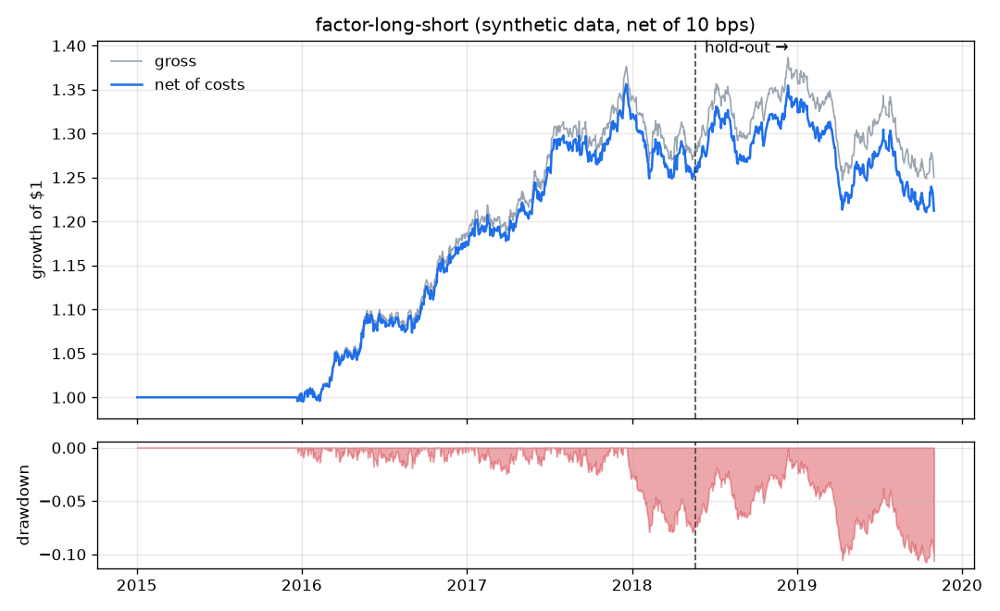

# Strategy #1: Factor long-short

**Code:** `src/quantskills/strategies/factor_long_short.py` · **Book:** ML4T 3rd ed., ch. 7 (labels, IC) and ch. 8 (price features) · **Status:** Phase 1, synthetic data only

## Hypothesis
A blend of cross-sectional price factors ranks next-month returns better than
chance. The factors are 12-1 momentum, 1-month reversal and low volatility.
Going long the top quintile and short the bottom quintile, dollar neutral,
should earn a positive return net of costs.

## Method
1. Compute each factor from past prices only and z-score it across tickers each day.
2. **Fit on the training window only:** measure each factor's mean Spearman IC
   against 21-day forward returns (sampled every 21 days, so the windows don't
   overlap) and use the signed ICs as blend weights. An equal-weight option exists.
3. Every 21 trading days, go long the top 20% and short the bottom 20% of the
   blended score. Positions are equal-weighted, with gross exposure 1.0.
4. Backtest with 5 bps commission + 5 bps slippage per unit traded. Positions
   drift between rebalances and costs are charged on the drifted book.
5. Hold out the last 30% of dates and look at it once.

## Results (synthetic data, seed 0, 30 assets, 10 bps costs)

These are **illustrations of the pipeline on simulated prices**. They are not
evidence about real markets and not expected returns.

| Panel | Period | Sharpe (net) | Sharpe (gross) | Ann. return | Max DD | Turnover/yr | DSR |
|---|---|---|---|---|---|---|---|
| Planted momentum | In-sample | 1.42 | 1.53 | 9.8% | -8.0% | 7.0x | 0.99 (N=1) |
| Planted momentum | Hold-out | **-0.36** | -0.23 | -2.6% | -10.6% | 9.0x | 0.33 |
| Pure noise (null) | In-sample | 1.32 | 1.49 | 9.7% | -7.5% | 12.0x | 0.98 (N=1) |
| Pure noise (null) | Hold-out | -0.31 | -0.11 | -2.4% | -11.5% | 14.2x | 0.35 |

After sweeping 12 configurations in-sample (`skills/evaluation/scripts/select_and_deflate.py`),
the winner's in-sample Sharpe is 1.53 against a null threshold of 1.43. That gives
**DSR = 0.56**, so the in-sample result is consistent with luck from the search.
The winner's hold-out Sharpe is -1.0.

### What this shows
- **In-sample numbers are not evidence.** The noise panel gets almost the same
  in-sample Sharpe as the planted one, because the IC weights were fitted on
  the same window they are scored on.
- The hold-out and the DSR both catch it. That is the point of rules 5 and 6 in `CLAUDE.md`.
- The planted signal is deliberately weak: a daily drift std of 4 bps against
  1.5% idiosyncratic noise. With `drift_vol=0.001`, momentum's training IC is
  reliably positive (see `tests/strategies`).

## Failure modes
- **Momentum crashes:** sharp reversals after market drawdowns hit the short leg.
- **Low-vol ≈ short beta.** In an up-trending market low-vol gets a negative
  IC and turns into a beta bet (visible in the fitted weights: about -0.33 on low-vol).
- **Costs:** monthly quintile rebalancing turns over 7–14x per year. At 40 bps
  round-trip the edge disappears.
- **Survivorship:** on real data, a current-constituent universe inflates results.
- **Missing factors:** value and quality need point-in-time fundamentals. They are deferred.

## Next steps
- Run on cached real data (`--data cache`) with a survivorship-aware universe.
- Walk-forward re-fitting instead of a single train/test split.
- Robustness report (PBO, perturbation tests) in Phase 4.
