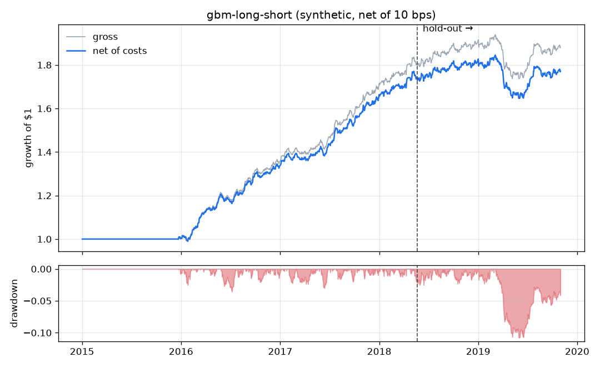

# Strategy #6: Gradient-boosted long-short (LightGBM + SHAP, purged CV)

**Code:** `src/quantskills/strategies/gbm_long_short.py`, `src/quantskills/models/gbm.py` · **Book:** ML4T 3rd ed., ch. 12 (gradient boosting, SHAP), ch. 6/7 (purged CV) · **Status:** Phase 3, synthetic data only

## Hypothesis
Trees can capture non-linear interactions between price features (e.g. momentum
that only works in low-volatility names) that the linear model of #2 misses.

## Method
1. Same features and rank label as #2, from past prices only.
2. **LightGBM regression with guard rails:**
   - Shallow trees: 15 leaves.
   - At least 200 rows per leaf.
   - Feature and row subsampling.
   - L2 penalty.
3. **Purged CV picks the number of trees.** In each of 4 purged, embargoed folds,
   training stops early when the held-out fold stops improving. The median of those
   stopping points is used to refit on the whole training window.
4. **SHAP values** come from LightGBM's built-in TreeSHAP (`pred_contrib=True`),
   reported as mean |SHAP| per feature. No separate `shap` dependency.
5. Long the top 20%, short the bottom 20% every 21 days; 10 bps; the last 30% is held out.

## Results (synthetic-plus panel, seed 0, 10 bps costs)

Illustrations only.

| | Value |
|---|---|
| CV fold IC | 0.110, -0.033, 0.014, -0.020 |
| Early-stopping rounds per fold | 25, 1, 5, 2 → **3 trees** |
| In-sample Sharpe | 3.47 |
| **Hold-out Sharpe** | **0.21** (90% credible interval [-1.14, 1.54]) |
| Hold-out gross Sharpe | 0.45 |
| Turnover | 16.0x / yr |

Mean |SHAP| (×1e-3): 12-1 momentum 3.2, 21-day reversal 1.3, 6-1 momentum 1.1,
21-day vol 0.9, 63-day vol 0.4, distance from SMA50 0.2, 5-day reversal 0.0.

### What this shows
- **The CV is the honest part.** Three of four folds say "stop almost immediately",
  so the model is tiny (3 trees). With little signal, early stopping on purged
  folds does its job.
- **The in-sample Sharpe of 3.47 is the classic overfitting picture.** Even 3 trees
  fitted on the training window rank that same window very well. On the hold-out it
  drops to 0.21. It is the most flexible model here and has the largest in-sample/hold-out gap.
- SHAP ranks 12-1 momentum first, which is the effect planted in the data, so the
  explanation matches what the data actually contain.

## Robustness
Verdict: **RED** (`uv run python skills/robustness/scripts/robustness_report.py --strategy gbm-long-short`). Every check runs walk-forward inside the training window except the last row. Method: [docs/robustness.md](../../docs/robustness.md).

| Check | Value | Rule | Status |
|---|---|---|---|
| Deflated Sharpe | 0.381 (SR 0.34 vs 0.57, N=10) | ≥ 0.95 green, ≥ 0.5 amber | red |
| PBO (CSCV) | 0.58, P(loss) 0.20, 9 configs | PBO ≤ 0.25 or P(loss) ≤ 0.1 green | amber |
| Sensitivity (worst / base) | — (base SR 0.34 < 0.5) | ≥ 0.5 green, ≥ 0.0 amber | n/a |
| Price noise 25 bps | — (base SR 0.34 < 0.5) | ≥ 0.75 green, ≥ 0.4 amber | n/a |
| Trade 1 day late | — (base SR 0.34 < 0.5) | ≥ 0.75 green, ≥ 0.4 amber | n/a |
| Worst regime Sharpe | -0.18 (down trend) | ≥ 0.0 green, ≥ -1.0 amber | amber |
| Walk-forward / in-sample | 0.10 (SR 3.47 → 0.34) | ≥ 0.5 green, ≥ 0.0 amber | amber |
| Hold-out / in-sample | 0.06 (SR 3.47 → 0.21) | ≥ 0.5 green, ≥ 0.0 amber | amber |

The overfitting is visible without the hold-out: walk-forward inside the training window gives 0.34 against 3.47 in-sample, and the DSR is red. The sensitivity surface points to smaller trees (7 leaves scores 1.23 walk-forward). Adopting that would be a new trial, and DSR would have to count it.

## Failure modes
- **Overfitting:** flexible models fit noise. Watch the in-sample/hold-out gap and the DSR,
  and count every hyperparameter tried as a trial.
- **Leakage through CV:** random K-fold would let overlapping 21-day labels leak
  across folds and inflate the CV IC. `purged_kfold` prevents that.
- **Turnover:** tree predictions jump around more than linear ones (16x a year).
- **Survivorship and costs** as for #1.

## Next steps
- Walk-forward retraining; a classification objective; monotone constraints on momentum.
- Smaller trees, as the sensitivity surface suggests (counted as a new trial).
