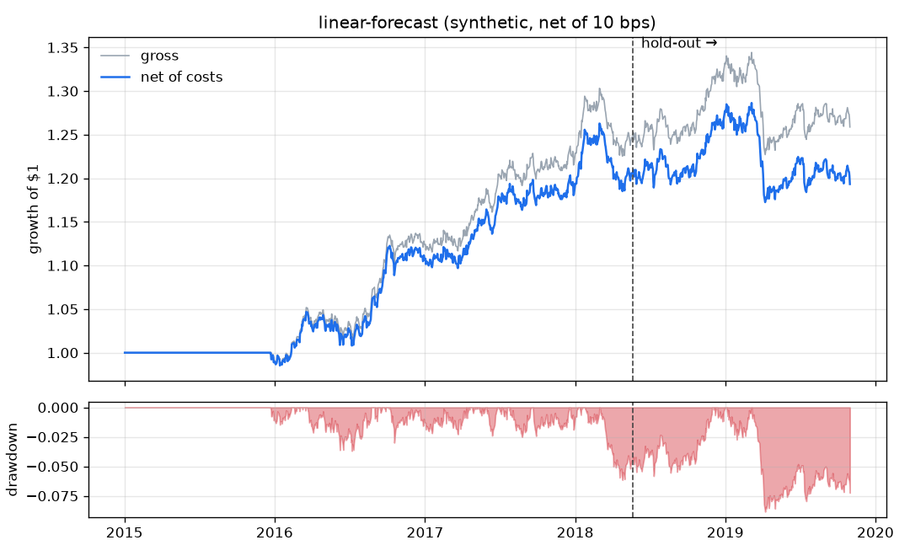

# Strategy #2: Linear return forecast

**Code:** `src/quantskills/strategies/linear_forecast.py` · **Book:** ML4T 3rd ed., ch. 11 (linear models in the ML pipeline), ch. 7 (labels, IC) · **Status:** Phase 3, synthetic data only

## Hypothesis
A regularised linear model of price features predicts which stocks will beat
their peers over the next 21 days. A long-short book on its ranking earns a
positive return net of costs.

## Method
1. **Features** (`features/panel.py`), computed from past prices only and z-scored
   across tickers each day: 12-1 and 6-1 momentum, 5- and 21-day reversal,
   21- and 63-day volatility, and distance from the 50-day average.
2. **Label:** the cross-sectional rank of the 21-day forward return (ridge, lasso),
   or "beats the cross-sectional median" (logistic direction model). Ranking against
   peers removes the market move, which a dollar-neutral book doesn't trade.
3. **Regularisation by purged CV.** The strength `alpha` is chosen by 4-fold
   **purged, embargoed** k-fold on the training window, scored by mean daily IC.
   Purging drops the 21 days before each test fold (their labels overlap it), and
   the embargo drops 5 days after it. Random K-fold would leak through those overlaps.
4. Refit on the whole training window. Every 21 days, go long the top 20% of
   predictions and short the bottom 20%, with gross exposure 1.0 and 10 bps costs.
5. The last 30% of dates are held out and touched once.

## Results (synthetic-plus panel, seed 0, 10 bps costs)

Illustrations of the pipeline on simulated prices. Not evidence about markets.

| Model | Chosen alpha (CV) | IS Sharpe | Hold-out Sharpe | Hold-out gross Sharpe | Turnover/yr |
|---|---|---|---|---|---|
| ridge (default) | 10,000 | 1.23 | **-0.07** | 0.13 | 13.4x |
| lasso | 0.001 | 1.63 | **-0.12** | 0.07 | 12.2x |
| logistic | 1 / C = 10,000 | 1.05 | **0.07** | 0.27 | 13.7x |

Hold-out 90% Bayesian credible interval for ridge's Sharpe: [-1.42, 1.26].

### What this shows
- The CV picks the **strongest** shrinkage in every grid. The data contain a weak
  momentum effect and a lot of noise, so a simpler model wins.
- The coefficients have the right sign: the momentum terms are the largest positive
  weights (ridge: +0.009 on 12-1 momentum). Lasso zeroes the reversal features.
- In-sample Sharpe of 1.0–1.6 becomes about 0 on the hold-out. The fit-on-train
  gap is the same one strategy #1 shows.
- Costs take 0.2 Sharpe at this turnover. Monthly quintile books trade about 13x a year.

## Failure modes
- **Linear in a non-linear world:** interactions (e.g. momentum only in calm names)
  are invisible to it. Strategy #6 tests whether trees find them.
- **Grid edge:** the chosen `alpha` sits at the edge of the default grid. Pass
  `alphas=(...)` to widen it. Every widening is another trial for the DSR.
- **Label choice matters:** rank labels ignore the size of moves. The logistic model
  discards even more information (only above or below the median).
- **Survivorship and costs** as for strategy #1.

## Next steps
- Walk-forward refits (`walk_forward_splits`) instead of a single split.
- Robustness report (PBO, perturbation) in Phase 4.
