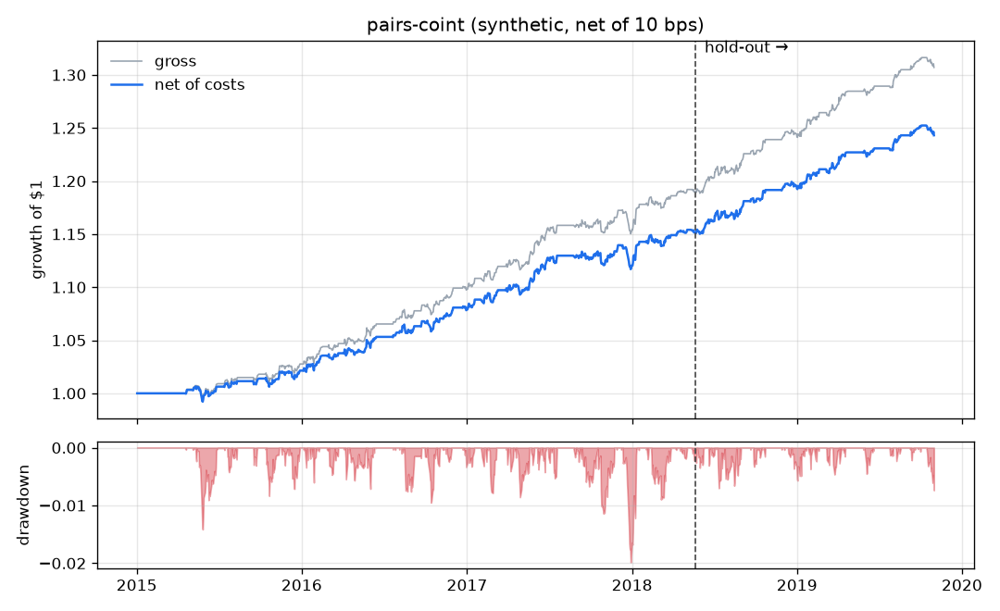

# Strategy #3: Pairs / stat-arb with cointegration

**Code:** `src/quantskills/strategies/pairs_coint.py`, `_pairs.py` · **Book:** ML4T 3rd ed., ch. 9 (stationarity, cointegration) · **Status:** Phase 3, synthetic data only

## Hypothesis
Some pairs of assets share a long-run equilibrium: their log prices are
**cointegrated**. When the spread between them stretches, it tends to snap back,
and betting on that reversion earns a return that barely depends on the market.

## Method
1. **Fit (training window only):**
   - Pre-filter the 40 most correlated pairs (by daily return correlation).
   - Test each pair for cointegration with Engle-Granger (default) or Johansen.
   - **Bonferroni correction:** with 40 tests, the p-value threshold is 0.05 / 40.
     Johansen uses its 99% critical value instead.
   - Keep up to 3 pairs, using each ticker once, and freeze the OLS hedge ratio.
2. **Spread** `s_t = log y_t - c - h * log x_t`, z-scored over the trailing 63 days (causal).
3. **Rules:**
   - Short the spread when z > 2, buy it when z < -2.
   - Exit inside ±0.5; stop out beyond ±4, since the relationship may have broken.
   - Long the spread means +1 unit of y and -h units of x, scaled so each pair uses
     a third of gross exposure.
4. Trade only when a position changes. Other days hold and let the book drift.
   10 bps costs; the last 30% is held out.

## Results (synthetic-plus panel, seed 0, 10 bps costs)

The panel has 3 planted cointegrated pairs among 31 other series. These are
illustrations of the pipeline, not evidence about markets.

| Variant | Pairs selected | IS Sharpe | Hold-out Sharpe | Hold-out vol | Hold-out max DD |
|---|---|---|---|---|---|
| Engle-Granger + Bonferroni (default) | the 3 planted pairs (p ≤ 0.0006) | 1.87 | **2.56** | 2.0% | -0.7% |
| Johansen (99% c.v.) | the 3 planted pairs | 2.18 | **2.94** | 2.0% | -0.8% |
| Engle-Granger, **no** correction, 6 pairs | 3 planted + `SYN13/SYN24` (p = 0.039) | 1.50 | **-0.59** | 4.3% | -9.1% |

Default, hold-out: 90% Bayesian credible interval for the Sharpe is [1.20, 3.90]; DSR 1.00 (N=1).

### What this shows
- When a real equilibrium exists, the test finds it and the trade works out of sample.
- **Multiple testing is the main risk.** Without the correction, one fluke "pair"
  (p = 0.039 among 40 tests) slips in and turns the hold-out negative. That fluke
  first appeared on a test panel during development, which is why the correction is
  on by default. Tightening a threshold after a bad result is itself a choice
  informed by data, so the hold-out numbers here are slightly optimistic.
- Low volatility (2%) means a high Sharpe on a small return. Real pairs books are
  levered, and leverage amplifies the failure modes below.

## Robustness
Verdict: **AMBER** (`uv run python skills/robustness/scripts/robustness_report.py --strategy pairs-coint`). Every check runs walk-forward inside the training window except the last row. Method: [docs/robustness.md](../../docs/robustness.md).

| Check | Value | Rule | Status |
|---|---|---|---|
| Deflated Sharpe | 0.948 (SR 2.04 vs 0.66, N=10) | ≥ 0.95 green, ≥ 0.5 amber | amber |
| PBO (CSCV) | 0.69, P(loss) 0.15, 9 configs | PBO ≤ 0.25 or P(loss) ≤ 0.1 green | amber |
| Sensitivity (worst / base) | 0.62 kept (worst SR 1.27) | ≥ 0.5 green, ≥ 0.0 amber | green |
| Price noise 25 bps | 0.88 kept (SR 1.80) | ≥ 0.75 green, ≥ 0.4 amber | green |
| Trade 1 day late | 0.93 kept (SR 1.89) | ≥ 0.75 green, ≥ 0.4 amber | green |
| Worst regime Sharpe | 1.37 (up trend) | ≥ 0.0 green, ≥ -1.0 amber | green |
| Walk-forward / in-sample | 1.09 (SR 1.87 → 2.04) | ≥ 0.5 green, ≥ 0.0 amber | green |
| Hold-out / in-sample | 1.37 (SR 1.87 → 2.56) | ≥ 0.5 green, ≥ 0.0 amber | green |

Survives every perturbation; amber only because the DSR is just below 0.95 and PBO is high on a plateau of profitable configs (P(loss) 0.15). Delay costs more after two days, since spreads revert quickly.

## Failure modes
- **Broken relationships:** mergers, index changes and regime shifts end
  cointegration without warning. The stop at |z| > 4 limits, but doesn't prevent, the damage.
- **Survivorship:** pairs found among today's listed names exclude those whose
  relationship ended in a delisting.
- **Shorting costs:** borrow fees and recalls are not modelled.
- **Fixed hedge ratio** goes stale. Strategy #5 updates it daily.

## Next steps
- Run on real ETF pairs (e.g. sector ETFs) from the cache.
