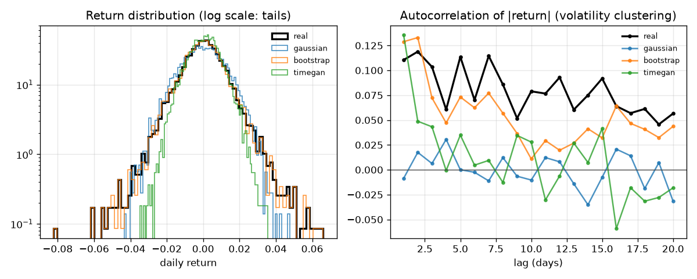
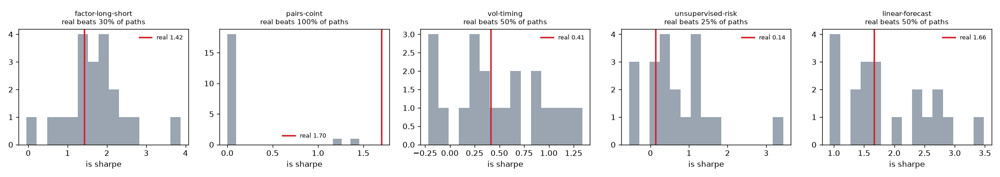

# #11 (stretch): Synthetic histories for stress tests

**Code:** `src/quantskills/robustness/stress.py`, `models/timegan.py` · **Book:** ML4T 3rd ed., ch. 5 (synthetic financial data, TimeGAN) · **Status:** Phase 5 stretch, synthetic data only · **TimeGAN needs:** `uv sync --extra dl`

Unlike the other entries, #11 is **not a trading strategy**. It's a tool for testing
strategies, so it isn't in the strategy registry or the terminal's lab. It lives in the
robustness module.

## Idea
A backtest is one path through history. Fit a generator to the returns, draw many
alternative histories with the same risk, and rerun the strategy on each. That gives a
Sharpe *distribution* instead of one number, and shows which features of the data the
strategy depends on.

## Generators
| Generator | Keeps | Loses |
|---|---|---|
| `gaussian`: i.i.d. normal with the sample mean and covariance | volatility, correlations, each stock's mean | fat tails, volatility clustering, every time-series signal |
| `bootstrap`: stationary block bootstrap of whole days (mean block 20) | tails, same-day correlations, short-range dependence, each stock's mean | price levels (so cointegration), anything slower than a block |
| `timegan`: a compact TimeGAN (GRU embedder, recovery, generator, supervisor, discriminator) | in principle, joint dynamics within a 24-day window | the link between windows (they are chained independently) |

The TimeGAN is written from scratch after Yoon et al. (2019). It has three deviations,
needed for a laptop CPU budget of hundreds of steps where the paper uses tens of thousands:
- single-layer GRUs;
- a tanh squash instead of min-max scaling, because with fat tails min-max collapsed
  every output to near-zero volatility;
- a moment loss that also matches cross-asset covariance and lag-1 autocorrelation;
  without it, generated assets came out 0.98 correlated.

It passes the usual sanity check on noisy sine waves: it reproduces their scale,
smoothness, variety and independence.

## How realistic? (`stress_report.py --fidelity`)
Scored on `stylized_prices`: 5 assets with GARCH volatility and Student-t shocks, which
gives fat tails (excess kurtosis 2.5), volatility clustering (|r| autocorrelation 0.10)
and correlation 0.53. 5 paths per generator.

| | Ann. vol | Skew | Excess kurtosis | ACF(1) returns | ACF \|r\| lags 1–5 | Mean correlation | Discriminative ↓ | TSTR error (TRTR 0.0056) |
|---|---|---|---|---|---|---|---|---|
| **real** | 0.188 | 0.07 | **2.53** | -0.00 | **0.101** | **0.53** | — | — |
| gaussian | 0.186 | -0.02 | -0.02 | 0.00 | -0.002 | 0.53 | 0.22 | 0.0058 |
| **bootstrap** | 0.190 | 0.09 | 2.66 | -0.00 | 0.086 | 0.53 | **0.01** | 0.0056 |
| timegan (300 steps/phase) | 0.132 | -0.01 | -0.05 | **0.34** | 0.031 | **0.99** | 0.50 | 0.0053 |

*Discriminative* = |accuracy − 0.5| of a cross-validated classifier telling 24-day real
windows from fake ones (0 = indistinguishable; with ~50 windows per class, differences
under ~0.1 are noise). *TSTR / TRTR* = error of a volatility forecast trained on
synthetic (or real) data and tested on real data.

**What this shows**
- **The block bootstrap is the practical tool.** It reproduces every fact we measured, and
  the classifier cannot tell its windows from real ones (0.01). It can only reshuffle the
  past, though: it never produces a crash bigger than the worst day it saw.
- **The Gaussian baseline** gets volatility and correlation right and nothing else; the
  classifier spots the missing tails (0.22).
- **Our TimeGAN does not produce usable returns at this budget.** It gets the volatility
  roughly right, but every asset moves in lockstep (0.99 correlation), the tails are gone
  and the returns are autocorrelated, so the classifier separates it perfectly (0.50).
  Getting it this far took three fixes, each documented in `models/timegan.py`:
  - train on window *price paths* rather than returns, as the paper did with stock
    prices: on returns the supervisor squashed volatility to 0.016;
  - a tanh squash instead of min-max scaling;
  - covariance matching.
  Its low TSTR error is not a success: a volatility forecast trained on smooth data learns
  to predict "about average", which is hard to beat on this panel.
- GANs need far more data and compute than one five-year panel offers. Here, use the
  bootstrap for stress tests and treat the TimeGAN as a demonstration of the method.

## Stress test (`stress_report.py --stress ...`)
Each strategy runs on 20 block-bootstrapped versions of the synthetic-plus **training
window** (each split 70/30 like the real one), so the real hold-out is never used.

| Strategy | Real in-sample Sharpe | Bootstrap paths: median | 90% range | Real beats |
|---|---|---|---|---|
| #1 factor long-short | 1.42 | 1.71 | [0.49, 2.69] | 30% |
| #2 linear forecast | 1.66 | 1.66 | [1.03, 2.95] | 50% |
| #3 pairs | 1.70 | 0.00 | [0.00, 1.23] | **100%** |
| #4 vol timing | 0.41 | 0.43 | [-0.22, 1.22] | 50% |
| #7 HRP | 0.14 | 0.50 | [-0.48, 1.71] | 25% |

`uv run python skills/robustness/scripts/stress_report.py --stress factor-long-short linear-forecast pairs-coint vol-timing unsupervised-risk --paths 20 --figures`
(the real Sharpe here is on the training window split 70/30, so it differs from the gallery).

**What this shows**
- **Pairs lives on price levels.** Shuffling days in blocks keeps every return but breaks
  the levels, so cointegration disappears: no pair passes the test on most paths (Sharpe 0).
  The real result beats every path, which says the edge is *structural*, not noise.
- **Momentum survives the shuffle.** The bootstrap keeps each stock's average return,
  and on a short sample, 12-month momentum mostly picks up those average differences.
  So the factor strategies (#1, #2) do as well on shuffled histories as on the real one.
  That's a reminder that cross-sectional momentum on few years of data is close to "buy
  what went up on average".
- **Vol timing and HRP sit mid-distribution:** their real results are typical of histories
  with the same risk, neither lucky nor unlucky.
- **The spread is the point.** The same strategy on statistically identical histories
  ranges over about 2 Sharpe units. One backtest is one draw.

## Failure modes
- **A generator only tests what it keeps.** A strategy that beats every bootstrap path is
  using something the bootstrap destroyed (levels, slow drift). That is a diagnosis, not a
  verdict.
- **Small samples:** one history of 880 days gives a generator very little to learn from;
  TimeGAN especially.
- **Chained windows** have no memory across window boundaries.

## Next steps
- Regime-conditional generation (e.g. stress only from high-volatility periods).
- A longer TimeGAN training budget on real cached data.
