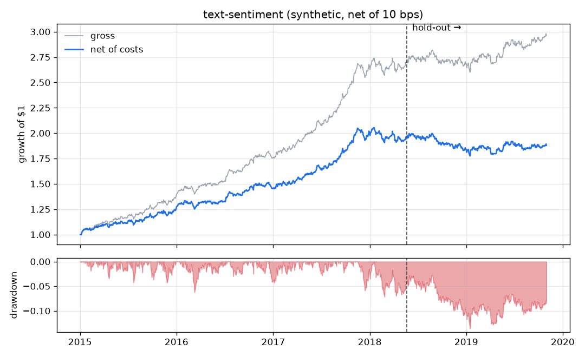

# Strategy #8: News sentiment long-short

**Code:** `src/quantskills/strategies/text_sentiment.py`, `models/text.py`, `data/news.py` · **Book:** ML4T 3rd ed., ch. 10 (text feature engineering) · **Status:** Phase 5, synthetic data only

## Hypothesis
Headlines carry information the market prices with a delay. Score each headline's
tone, add up each stock's recent tone, buy the most positive names and sell the most
negative ones.

## Data: synthetic headlines
There is no free, licence-clean, point-in-time news archive to bundle, so tests and
demos use a generator (`synthetic_news`). It is offline and reproducible:
- About 10% of (day, stock) pairs get a headline, such as "SYN07 raises full-year
  guidance" or "Update: SYN12 faces regulatory probe".
- With probability `strength` (default 0.2), a headline's tone matches the sign of the
  stock's **next** 5-day return relative to the market. Otherwise its tone is random.
  The *generator* looks ahead so the news is informative; the *strategy* only reads
  headlines dated on or before the day it trades.
- 30% of negative headlines are written with positive words plus a negator ("fails to
  beat earnings estimates"), a trap for naive word counting.
- `strength=0` gives a null panel where the news is pure noise.

News travels with the prices in `prices.attrs["news"]` (`attach_news`), so the
`Strategy` interface is unchanged. Pandas keeps the *whole* news frame on every
date slice, so the strategy cuts it with `news_until(data)`. A test scrambles future
headlines and checks that past weights don't move.

To use real news, build a `date, ticker, headline` frame (publication date, not
event date) and `attach_news(prices, news)`.

## Method
1. **Tone** per headline, either:
   - `model="lexicon"`: +1 per positive word, -1 per negative word, with "not",
     "fails", "no longer" flipping the next three words. Nothing is fitted.
   - `model="tfidf"` (default): word and word-pair TF-IDF with logistic regression for
     "beats the market over the next 5 days", fitted on training-window headlines only.
     Ticker symbols are stripped, so the model learns language rather than names.
2. **Signal:** the sum of each stock's tone over the last 5 days. Stocks with no recent
   news are left out.
3. Every 5 days, long the top 25% and short the bottom 25% (with at least 6 names with
   news), gross 1.0, 10 bps costs. The last 30% is held out.

## Results (synthetic-plus panel + headlines, seed 0, 10 bps costs)

Illustrations of the pipeline on simulated data, not evidence about markets.

| Variant | IS Sharpe | Hold-out Sharpe |
|---|---|---|
| TF-IDF (default) | 2.11 | **-0.28** (gross 0.73) |
| Lexicon | 1.86 | **0.97** |
| TF-IDF, **null** news (`strength=0`) | 0.66 | 0.17 |
| Lexicon, null news | -0.75 | -1.73 |

Hold-out 90% Bayesian interval for the default: [-1.63, 1.05]. Turnover is 88x a year.
Headline-tone IC with the next 5-day return: 0.12.

Over three seeds (0, 1, 2) during development, the default's hold-out Sharpe was -0.28,
2.30 and 1.31, and the lexicon's 0.97, 2.04 and 1.33. Trials: 2 models x 2 rebalance
frequencies x 3 news strengths were tried before fixing the defaults.

### What this shows
- **The signal is there; the costs eat it.** Gross of costs, the hold-out Sharpe is
  0.73. The book turns over 88x a year because the set of stocks with recent news keeps
  changing, and 10 bps a trade takes about 1 Sharpe.
- **TF-IDF fits noise too.** On null news it still scores 0.66 in-sample. Only the
  lexicon, which fits nothing, shows the null panel's true colour (and loses to costs).
- **One hold-out is a noisy judge** at this signal strength. Across seeds the default
  ranged from -0.28 to 2.30.

## Robustness
Verdict: **RED** (`uv run python skills/robustness/scripts/robustness_report.py --strategy text-sentiment`). Every check runs walk-forward inside the training window except the last row. Method: [docs/robustness.md](../../docs/robustness.md).

| Check | Value | Rule | Status |
|---|---|---|---|
| Deflated Sharpe | 0.817 (SR 1.10 vs 0.42, N=10) | ≥ 0.95 green, ≥ 0.5 amber | amber |
| PBO (CSCV) | 0.77, P(loss) 0.10, 9 configs | PBO ≤ 0.25 or P(loss) ≤ 0.1 green | amber |
| Sensitivity (worst / base) | 0.66 kept (worst SR 0.73) | ≥ 0.5 green, ≥ 0.0 amber | green |
| Price noise 25 bps | 1.32 kept (SR 1.46) | ≥ 0.75 green, ≥ 0.4 amber | green |
| Trade 1 day late | 0.37 kept (SR 0.41) | ≥ 0.75 green, ≥ 0.4 amber | red |
| Worst regime Sharpe | 0.07 (high vol) | ≥ 0.0 green, ≥ -1.0 amber | green |
| Adversarial text | 0.66 kept (worst: paraphrase, SR 0.66) | ≥ 0.75 green, ≥ 0.4 amber | amber |
| Walk-forward / in-sample | 0.52 (SR 2.11 → 1.10) | ≥ 0.5 green, ≥ 0.0 amber | green |
| Hold-out / in-sample | -0.13 (SR 2.11 → -0.28) | ≥ 0.5 green, ≥ 0.0 amber | red |

A day's delay removes most of the edge (walk-forward 1.10 → 0.41, negative at two days): the planted news is priced within days, as real news tends to be. Paraphrased negation costs TF-IDF a third of its Sharpe. Pump spam doesn't fool it (it never saw those words), but the same spam wipes out the lexicon variant (1.92 → 0.01; see [docs/robustness.md](../../docs/robustness.md#adversarial-text)).

## Failure modes
- **Look-ahead through timestamps:** real feeds stamp the *event* or the *update* time.
  Use the first publication time, and trade the next day if it came after the close.
- **Costs:** news-driven books turn over fast. Hold longer or trade only big tone changes.
- **Adversarial and low-quality text:** spam, paraphrase and new vocabulary move the
  signal (see Robustness). Real feeds also contain duplicates and syndicated rewrites.
- **Survivorship** as for #1. Delisted firms' bad news is missing from today's archives.

## Next steps
- A real news source with publication timestamps.
- Sentence embeddings instead of TF-IDF (stays optional: it would need the `dl` extra).
