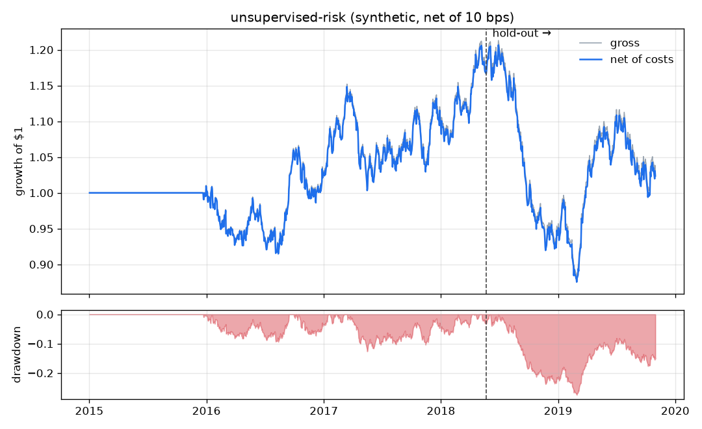

# Strategy #7: Unsupervised risk factors (HRP, PCA eigenportfolios)

**Code:** `src/quantskills/strategies/unsupervised_risk.py`, `src/quantskills/portfolio/` · **Book:** ML4T 3rd ed., ch. 14 (PCA, latent factors), ch. 17 (HRP, portfolio construction) · **Status:** Phase 3, synthetic data only

## Hypothesis
Allocating by the *structure* of risk, learned without labels from past returns,
gives a steadier portfolio than naive weights. It needs no return forecasts,
which are the noisiest input in portfolio construction.

## Method
Every 21 days, using only the trailing 252 days of returns (so the strategy is
out-of-sample by construction; `fit` learns nothing):

- **`hrp`** (default): Hierarchical Risk Parity, written from the paper's description.
  - Cluster assets by correlation distance `sqrt((1 - rho) / 2)`.
  - Order them by the dendrogram.
  - Split the budget recursively, giving each half weight in inverse proportion to
    its variance. No matrix inversion, so it is stable when the covariance is nearly singular.
- **`eigen`:** the k-th PCA eigenportfolio, `w_i ∝ v_ik / sigma_i`. k=0 is the
  market-like first component; higher k are long-short statistical factors.
- **Baselines:** `min_var` (SLSQP, long-only), `inverse_vol`, `equal`.

Covariance uses Ledoit-Wolf shrinkage. Long-only allocators are fully invested
(gross 1.0); 10 bps costs; the last 30% is held out.

## Results (synthetic-plus panel, seed 0, 10 bps costs)

Illustrations only. The hold-out contains a market drawdown, so every long-only
book loses. The question is how much.

| Method | IS Sharpe | Hold-out Sharpe | Hold-out vol | Hold-out max DD | Turnover/yr |
|---|---|---|---|---|---|
| `equal` | 0.32 | -0.90 | 15.7% | -35.0% | 0.6x |
| `inverse_vol` | 0.37 | -0.86 | 15.2% | -33.4% | 0.7x |
| `eigen` (k=0) | 0.28 | -0.98 | 16.3% | -36.4% | 0.7x |
| **`hrp`** (default) | 0.56 | **-0.60** | 13.2% | -27.4% | 1.7x |
| `min_var` | 1.15 | **0.51** | 10.6% | -16.7% | 1.9x |

### What this shows
- **Risk-based allocators do what they promise:** lower vol and smaller drawdowns
  than equal weight. HRP sits between inverse-vol and min-variance.
- **Min-variance wins here** because the synthetic panel has a clean one-factor
  structure, few assets and a shrunk covariance. That is where its usual weakness,
  inverting a noisy matrix, matters least. HRP's advantage shows up with many
  correlated assets and short windows.
- The first eigenportfolio behaves like equal weight, as expected for "the market" factor.
- The planted pairs show up as tight clusters in the HRP dendrogram and in the RISK screen's heatmap.

## Robustness
Verdict: **RED** (`uv run python skills/robustness/scripts/robustness_report.py --strategy unsupervised-risk`). Every check runs walk-forward inside the training window except the last row. Method: [docs/robustness.md](../../docs/robustness.md).

| Check | Value | Rule | Status |
|---|---|---|---|
| Deflated Sharpe | 0.847 (SR 0.85 vs 0.08, N=10) | ≥ 0.95 green, ≥ 0.5 amber | amber |
| PBO (CSCV) | 0.81, P(loss) 0.14, 9 configs | PBO ≤ 0.25 or P(loss) ≤ 0.1 green | amber |
| Sensitivity (worst / base) | 1.00 kept (worst SR 0.85) | ≥ 0.5 green, ≥ 0.0 amber | green |
| Price noise 25 bps | 1.03 kept (SR 0.88) | ≥ 0.75 green, ≥ 0.4 amber | green |
| Trade 1 day late | 0.98 kept (SR 0.84) | ≥ 0.75 green, ≥ 0.4 amber | green |
| Worst regime Sharpe | 0.00 (up trend) | ≥ 0.0 green, ≥ -1.0 amber | green |
| Walk-forward / in-sample | 1.52 (SR 0.56 → 0.85) | ≥ 0.5 green, ≥ 0.0 amber | green |
| Hold-out / in-sample | -1.07 (SR 0.56 → -0.60) | ≥ 0.5 green, ≥ 0.0 amber | red |

Nothing in the training window predicted the hold-out loss: walk-forward, noise, delay and the lookback grid all look fine. A reminder that these checks are necessary, not sufficient.

## Failure modes
- **Correlations break in crises:** everything correlates at once, and diversification
  learned from the past window disappears when it's needed.
- **Window choice:** 252 days mixes regimes, while shorter windows are noisy.
- **Long-only:** these are allocation rules, not alpha. They can't avoid a falling market.

## Next steps
- PCA residual mean-reversion (statistical-arbitrage eigenportfolios).
- Compare out-of-sample variance across allocators with many assets.
