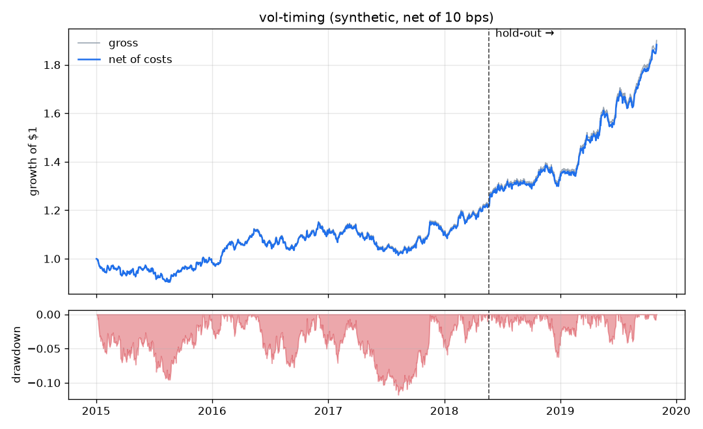

# Strategy #4: Volatility timing (GARCH)

**Code:** `src/quantskills/strategies/vol_timing.py` · **Book:** ML4T 3rd ed., ch. 9 (ARIMA, GARCH) · **Status:** Phase 3, synthetic data only

## Hypothesis
Volatility clusters and can be forecast even when returns can't. Scaling
exposure by forecast volatility (`target_vol / sigma_hat`) keeps risk roughly
constant. That cuts drawdowns, and has historically improved return per unit of
risk (Moreira & Muir, 2017).

## Method
1. **Fit (training window only):** estimate GARCH(1,1) with `arch` on the daily
   returns of one asset. It uses `SPY` if present, otherwise the first ticker, or
   the asset named by `ticker=`. With `direction="ar1"` the mean is AR(1).
2. **Forecast with frozen parameters:**
   `sigma²_{t+1} = omega + alpha·eps_t² + beta·sigma²_t`. The forecast made at *t*
   uses returns up to *t* only. A look-ahead test checks this.
3. **Size:** weight = min(10% / forecast annual vol, 2x leverage), rebalanced every 5 days.
   With `direction="ar1"` the position is cut to zero when the AR(1) mean forecast is negative.
4. 10 bps costs; the last 30% is held out.

## Results (synthetic `IDX`: GARCH(1,1) with α=0.08, β=0.90; seed 0; 10 bps)

Illustrations only. `IDX` has a planted positive drift, so **every long strategy
looks good on its hold-out**. The comparison against buy-and-hold is what matters.

| Variant | Fitted α, β | Hold-out Sharpe | Hold-out vol | Hold-out max DD | Turnover/yr |
|---|---|---|---|---|---|
| Buy and hold `IDX` | — | 2.83 | 16.6% | -9.7% | 0 |
| Constant 0.6x leverage (same average vol) | — | 2.82 | 10.0% | -5.9% | 0 |
| **GARCH vol target 10%** (default) | 0.05, 0.85 | **2.87** | 10.3% | -6.2% | 1.8x |
| GARCH + AR(1) direction filter | 0.05, 0.84 | 1.72 | 8.7% | -6.3% | 15.5x |

### What this shows
- The vol target works as a *risk* tool: realised hold-out vol is 10.3% against a
  10% target, and the drawdown shrinks with it.
- It barely beats a constant 0.6x position. On this data GARCH volatility is
  forecastable, but the drift doesn't depend on volatility, so timing adds little
  Sharpe. The empirical claim depends on the "high vol, poor reward" pattern of
  real markets, which this simulation doesn't contain.
- The AR(1) direction filter **hurts**. The fitted AR coefficient (-0.08) is noise,
  and acting on it multiplies turnover by 8.
- On the main synthetic panel (constant vol), GARCH correctly estimates α ≈ 0: no clustering, nothing to time.

## Failure modes
- **Volatility jumps:** GARCH reacts after a shock, not before. A crash
  day is taken at full size.
- **Leverage:** capping at 2x matters. In calm periods the formula asks for more.
- **Parameter drift:** parameters are frozen at the end of training. Long hold-outs need refits.

## Next steps
- Run on cached SPY data and compare against buy-and-hold at equal average vol.
- EGARCH / GJR for asymmetric (leverage-effect) volatility.
